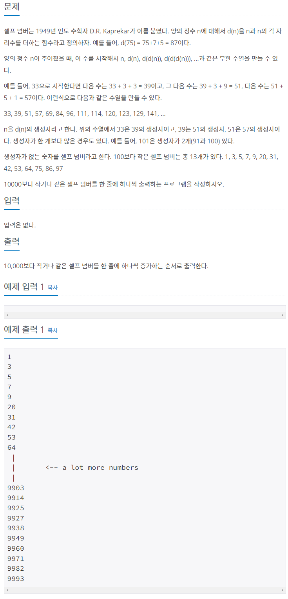

## 정답 코드 전문

```python
# 4673
# n을 d(n)의 생성자라고 하자.
# 즉 d(n)은 생성자가 있는, 셀프넘버가 아닌 숫자다.
natural = set(range(1, 10001)) # set안에 1부터 10000까지 숫자 생성
generated = set() # 빈 set 설정

for n in range(1, 10001): # 1부터 10000까지 for문 생성
    for j in str(n): # d(n)을 구하기 위한 for문
        n += int(j) # n(자기자신)에 각 자리수를 더해주어 d(n)을 구한다.
    generated.add(n) # d(n) 집어 넣기
self_num = sorted(natural - generated) # 1~10000 set에서 생성자가 있는 d(n)들을 삭제하고 정렬
for i in self_num:
    print(i)
```

### 주목해야 할 포인트

1. 셋 set 사용

2. for문 중첩해서 n에 대해 int -&gt; str -&gt; int 자유로운 형 변환 이용

3. 문제에 대한 이해 : 시작점에 따라 수열이 달라진다는 것을 이해할 것. 1로 시작할 때, 3으로 시작할 때, 수열이 다르다.

**1부터 10000사이의 숫자 n이 있을 때, 그 n으로 d(n)을 계산하면 d(n)의 생성자는 n이 된다.**

따라서 1부터 10000까지의 숫자에서 나올 수 있는 모든 **d(n)**들을 **generated se**t에 냅다 집어넣고, **natural set**에서 **generated set**을 빼주면 **"난 생성자가 없어.. 선택되지 않았어.."** 하는 **self_num set(셀프넘버)**이 구해진다.

다시 말해 1부터 10000까지 중에서 **d(n)**(생성자가 있는 숫자)를 삭제해주면 **셀프 넘버**(생성자가 없는 숫자)만 남는 것을 이용하자는 뜻.

## 코드 뜯어보기

```python
natural = set(range(1, 10001)) # set안에 1부터 10000까지 숫자 생성
generated = set() # 빈 set 설정
```

자연수 1~ 10000을 natural set에 넣어준다. 이 친구는 생성자가 없는 숫자를 골라내기 위한 용도로 쓰인다.

generated set는 d(n)들을 넣어줄 set이다. 빈방 상태로 시작한다.

```python
for n in range(1, 10001): # 1부터 10000까지 for문 생성
    for j in str(n): # d(n)을 구하기 위한 for문
        n += int(j) # n(자기자신)에 각 자리수를 더해주어 d(n)을 구한다.
    generated.add(n) # d(n) 집어 넣기
```

첫 번째 for문을 돌린다. 1부터 10000까지 돌리는 이유는, 1부터 10000 사이에서 나올 수 있는 생성자를 빠짐없이 찾기 위해서다. 문제에 있는 것처럼 d(d(d(... n)))수열식으로 꼬리 물면서 찾으면, 시작점에 따라 수열이 달라지는 셀프 넘버의 특성상 코드가 복잡해진다.

어.. 그래... 1부터 10000까지 계산한다고 하자.... generated set에 들어가는 숫자가 중복될 수 있잖아! 101 같은 경우는 생성자가 2갠데 어떡해? **-&gt;** **이는 중복을 허용하지 않는 set으로 해결**

그럼 이제 두 번째 for문을 보자. n를 str(n)으로 바꿨다!! **-&gt; indexing 해서 자릿수 씹고 뜯고 맛보려고...!**

그리고 indexing 되어 한 글자씩 뽑힌 j를 int(j)로 형 변환해준다. **-&gt; 사칙연산하려고..!... n += int(j) 하려고...!**

이렇게 각 자릿수를 원래 자기 수 n에 더해주면서 **d(n)이 생성!**

이 d(n)은 set에 인자를 넣어주는 add()를 사용해서 generated에 집어넣어 준다.

```python
self_num = sorted(natural - generated) # 1~10000 set에서 생성자가 있는 d(n)들을 삭제하고 정렬
for i in self_num:
    print(i)
```

그럼 이제 1부터 10000까지의 수가 들어있는 natural에서 생성자가 있는 d(n)들을 **모조리 빼준다.**

출력할 때 순서대로 나와야 하니까 sorted로 정렬도 해준다.

그럼.. 생성자 없는 self_num set이 완성....

for문으로 self_num 하나씩.. 하나씩 출력하면 끝

---

### 문제 후기

나는 d(d(d(d(... n)))) 방식으로 꼬리에 꼬리를 물면서 수열을 찾아나갔다. 그리고 n과 d(n) 사이에 있는 수를 출력하는 방식으로 풀었다. 이는 결국 틀렸습니다!!! ㅋ

이렇게 한 이유는 시작점에 따라 수열이 달라진다는 것을 몰랐기 때문이다. 하나의 수열만 정의되는 줄 알았다.

그리고 낑낑대다가 결국 내손으로 못 풀고 풀이를 찾아봤는데, 일단 쓱 보고 이해는 갔다. 그래서 주석까지 달아봤다.

다음 날 코드 분석을 해보는데, 일단 슥 보고 이해가 간 게 아니었다.  1도 제대로 모르고 있었다. 그동안 코드 보기 어려워서 주석만 보고 대강 이해했던 적이 많았다. 만약 주석이 잘못됐다면, 주석만 이해하고 코드를 활용할 줄 모른다면, 문제를 푸는 게 무슨 의미가 있을까 하고 반성했다.

갑분 오늘의 교훈

#### 이제 주석으로 이해하지 말고 코드로 이해하자

---

reference :

문제

[4673번: 셀프 넘버 (acmicpc.net)](https://www.acmicpc.net/problem/4673)

풀이

[백준 알고리즘 | 4673 : 셀프 넘버 (Python / 파이썬) (tistory.com)](https://wook-2124.tistory.com/252)

[🔗 백준 알고리즘 | 4673 : 셀프 넘버 (Python / 파이썬)](https://wook-2124.tistory.com/252)
