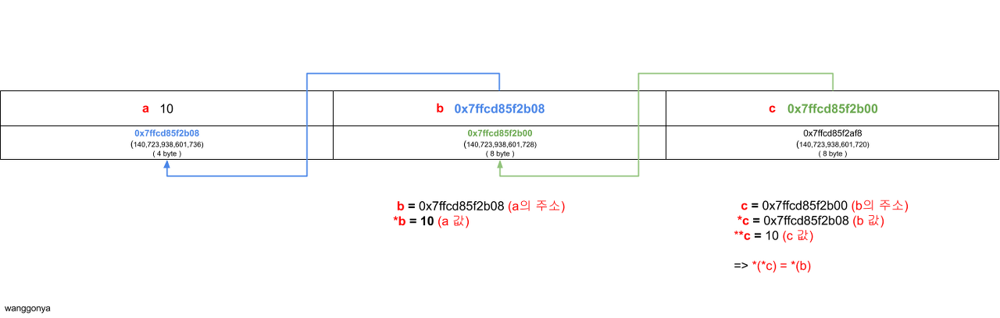

포인터에 대해 간단히 말하자면,
포인터란 해당 변수의 **메모리 공간 주소를 가리키는 변수**를 말한다. 변수에서 쓰는 * 표시는 역참조 표시이며, 해당 변수가 가리키는 메모리주소의 **값**을 가져오는 것을 의미한다. 사실 말로만 설명하면 이해하기 어려운 게 포인터다. 그래서 직접 주소값을 찍어보며 포인터 변수를 알아보았다.

```
int a = 10;
int *b = &a;
int **c = &b;
```

이렇게 세 가지의 변수를 선언했다.
a는 정수형 변수,
b는 포인터 변수,
c 또한 포인터 변수지만 b와 달리 **이중포****인터**로 선언했다.

a와 b, c의 메모리 주소값을 보자.

```html
printf("a address : %p\\n", &a);
printf("b address : %p\\n", &b);
printf("c address : %p\\n", &c);
```

printf로 a, b, c 세 변수의 주소값을 찍어봤을 때

```html
a address : 0x7ffcd85f2b08

b address : 0x7ffcd85f2b00

c address : 0x7ffcd85f2af8
```

이렇게 주소가 할당된 것을 볼 수 있다.
위에서 선언했듯이 int a에는 10을 선언했고, 포인터 변수 int *b에는 a의 주소값을 선언했다.
그리고 이중포인터 변수 int **c에는 포인터변수인 b의 주소를 선언했다. 그럼 이 세 변수의 관계는 어떻게 될까? 값들을 출력해 보자.

```bash
a value   : 10
a address : 0x7ffcd85f2b08

*b        : 10
b         : 0x7ffcd85f2b08
b address : 0x7ffcd85f2b00

*c        : 0x7ffcd85f2b08
**c       : 10
c         : 0x7ffcd85f2b00
c address : 0x7ffcd85f2af8
```

더 이해하기 쉽게 그림으로 살펴보자.



a의 메모리주소에는 10이라는 값이 들어있다. 그림을 보면 b에는 a의 메모리주소 들어있는 것을 볼 수 있다.
그럼 어떻게 b를 이용해서 a의 값인 10을 가져올 수 있을까? 바로 *** (역참조)**를 이용해야 한다.
b에 *(역참조)를 붙인 ***b** 는 **b가 가리키고 있는 메모리주소의 값**을 가져오라는 의미이다.
b에는 a의 메모리주소가 들어있고, 따라서 ***b**는 a의 메모리주소의 값인 **10**이 된다.

그럼 이중포인터인 c를 이용해서 a의 값인 10을 가져와보자.
위에서 선언했듯이 ****c**에는 **b의 메모리주소**를 넣었다.
**c의 값**에는 **b의 메모리주소**가 들어있다. c에 ***(역참조)**를 하나 붙여보자. **역참조**는 **해당 값(메모리주소)이 가리키는 값을 가져오라**는 의미이다. 따라서 ***c**는 **b의 메모리주소가 가리키는 값**이라는 것을 알 수 있다.
따라서 ***c**는 **b의 값**이므로, *c는 b의 값인 **a의 메모리주소**가 되는 것이다.

납득이 된다면, *(역참조)를 하나 더 붙인 ****c**는 무엇인지 생각해 보자.
*c는 b의 값이다. ****c**는 **b의 값(a의 메모리주소)이 가리키는 10**이 되는 것이다.

이렇게 **c를 통해 a의 값인 10을 가져올 수 있게 되었다.
또 **c = 100 같은 문장을 실행하게 되면 a의 값이 100으로 바뀌게 된다.

한 번에 이해하기가 어렵다면, 변수를 이리저리 움직이며 확인해 보자.

---

### 참고

#### 자료형 크기

```
int size : 4
int * size : 8
int ** size : 8
```

#### raw code

```cpp
#include <stdio.h>
int main(void)
{
    int a = 10;
    int *b = &a;
    int **c = &b;
    printf("int a = 10;\\nint *b = &a;\\nint **c = &b;\\n");
    printf("\\n");
    printf("a value : %d\\n", a);
    printf("a address : %p\\n", &a);
    printf("\\n");
    printf("*b : %d\\n", *b);
    printf("b : %p\\n", b);
    printf("b address : %p\\n", &b);
    printf("\\n");
    printf("*c : %p\\n", *c);
    printf("**c : %d\\n", **c);
    printf("c : %p\\n", c);
    printf("c address : %p\\n", &c);
    printf("\\n");
    printf("int size : %d\\n", sizeof(int));
    printf("int * size : %d\\n", sizeof(int *));
    printf("int ** size : %d\\n", sizeof(int **));
}
```

### 함께 보면 좋은 글

**c언어 이중포인터(double pointer)**
<https://m.blog.naver.com/PostView.naver?isHttpsRedirect=true&blogId=sharonichoya&logNo=220496504183>
**위키백과 - 포인터(pointer)**
<https://ko.wikipedia.org/wiki/%ED%8F%AC%EC%9D%B8%ED%84%B0_(%ED%94%84%EB%A1%9C%EA%B7%B8%EB%9E%98%EB%B0%8D)>
