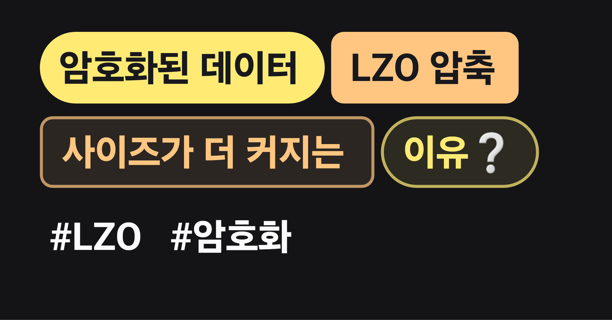

**0. 작성 배경?**

최근 RSA 암호화 데이터를 [LZO 압축](https://en.wikipedia.org/wiki/Lempel%E2%80%93Ziv%E2%80%93Oberhumer)해 보관해야 하는 로직을 구현하던 중에, 암호화 데이터를 압축했을 때 오히려 사이즈가 더 커지는 현상이 발생했다. 왜 이런 현상이 발생했는지 알아보자.

#### 1. 암호화 데이터는 무작위(random)한 특성을 가진다.

LZO를 포함한 대부분의 압축 알고리즘(LZ77, LZ78 기반 알고리즘)은 **데이터 내 반복되는 패턴을 찾아 제거**하여 압축률을 높이는 방식으로 동작한다. 하지만 **암호화된 데이터는 원래의 구조적 패턴이 제거된 상태**이므로 압축 알고리즘이 더 이상 **중복된 패턴을 찾을 수 없게 된다**.
즉, 압축 알고리즘이 **패턴을 찾지 못하면** 압축할 수 없으며, 오히려 압축 헤더 또는 메타데이터가 추가되면서 크기가 더 커질 수 있다.

#### 2. LZO는 빠른 압축을 위해 짧은 백참조(short back-references)와 헤더를 추가한다.

LZO는 일반적인 LZ77 계열 알고리즘처럼 데이터에서 **중복된 부분을 백참조(back-reference)로 대체**하여 압축한다.
하지만 **암호화된 데이터는 중복이 거의 없으므로 백참조를 만들 수 없고**, 결과적으로 **압축 알고리즘의 오버헤드(헤더, 인덱스, 길이 정보 등)가 추가**되면서 데이터가 더 커지는 현상이 발생한다.

#### 3. 암호화된 데이터는 이미 엔트로피(Entropy)가 극대화된 상태다.

- 엔트로피(Entropy)는 데이터의 **무작위성(Randomness) 정도**를 나타내는 지표다.
- 일반적으로 압축되지 않은 원본 데이터는 **낮은 엔트로피**를 가지며, LZO 같은 알고리즘은 이를 활용하여 패턴을 찾아 압축한다.
- 반면, 암호화된 데이터는 **최대한 균등한 확률로 분포된 비트(binary distribution)를 가지도록 설계**되었기 때문에 **이미 엔트로피가 극대화된 상태다**.
- 결과적으로, 압축 알고리즘이 적용되더라도 데이터 크기를 줄일 수 있는 요소가 없으며, 오히려 **압축 메타데이터만 추가되어 크기가 증가**하게 된다.

#### 4. LZO의 압축 오버헤드가 추가된다.

LZO는 데이터 압축을 위해 **매칭된 패턴의 오프셋과 길이를 저장하는 방식**을 사용한다. 하지만 암호화된 데이터에서는 의미 있는 매칭을 찾지 못하고, 결국 **모든 데이터가 "리터럴(literal)" 형태로 저장된다**.

- LZO는 **리터럴 데이터도 일정한 포맷으로 저장해야 하므로**, 작은 데이터 블록에도 **추가적인 메타데이터(길이, 오프셋 등)를 포함**하게 된다.
- 결과적으로, 압축되지 않은 데이터를 그냥 저장하는 것보다 **오버헤드가 추가되어 크기가 더 커지게 된다**.

#### 5. 해결 방법, 그리고 결론

암호화된 데이터는 **이미 무작위화(Randomized)되어 있어 패턴이 존재하지 않는다.**
→ 압축 알고리즘이 **중복을 찾을 수 없다.**

LZO는 빠른 압축을 위해 **짧은 백참조(short back-references)와 추가적인 헤더 정보를 저장한다.**
→ 암호화된 데이터에서는 **이 추가 오버헤드만 발생한다.**

**결과적으로, 압축이 불가능할 뿐만 아니라 크기가 증가**할 가능성이 높다.따라서 **실무에서 암호화된 데이터를 압축하려면, "암호화 전에 압축"하는 것이 필수적이다.**

다른 압축 효율이 높은 알고리즘을 고려하는 방법이 있지만, 나의 경우 gzip 또는 lzo 압축 방식으로 해결해야 하는 상황이었기 때문에, **압축 후 암호화하는 방향**으로 로직을 수정할 수 밖에 없었다.

---

#### 번외, LZO의 기본적인 내부 동작 방식

LZO는  **LZ77 변형 기반 압축 알고리즘으로,** 기본적인 내부 동작 방식은 다음과 같다.

1. **슬라이딩 윈도우 방식**으로 중복된 패턴을 탐색한다.
2. 발견된 중복 데이터는 **백참조(Back-reference) 기법**을 사용하여 저장한다.
3. 압축된 데이터는 **리터럴(literal) + 백참조(offset, length) 형식**으로 기록된다.
4. 압축 해제 시, 백참조를 따라 원본 데이터를 복원한다.

성능을 비교할만한 다른 알고리즘들은 ZSTD, LZ4, zlib 등이 있다.

| **알고리즘** | **압축 속도** | **압축률** | **압축 해제 속도** |
| --- | --- | --- | --- |
| **LZO** | 빠름 | 낮음 | 매우 빠름 |
| **ZSTD** | 보통 | 높음 | 빠름 |
| **LZ4** | 매우 빠름 | 낮음 | 매우 빠름 |
| **zlib** | 중간 | 중간 | 중간 |

이 중에서도 LZO는 **압축 해제 속도가 매우 빠른 장점**이 있어 **리눅스 커널, 네트워크 전송, 임베디드 시스템** 등에서 많이 사용된다. 다른 알고리즘들과 암호화 데이터 간 압축 효율에 대해 비교해보는 것도 흥미로울듯 하다.

#### 번외, LZO 사용하는 방법

1) 먼저, liblzo2를 설치해야 한다.

- Ubuntu/Debian

```bash
sudo apt-get install liblzo2-dev
```

-  CentOS/RHEL

```bash
sudo yum install lzo-devel
```

2) LZO를 사용할 때의 기본적인 구성은 크게 다음과 같다

- **LZO 초기화 (lzo_init())**
	- LZO 라이브러리를 사용하기 전에 초기화가 필요하다.
- **압축 (lzo1x_1_compress())**
	- 데이터를 압축하여 compressed 배열에 저장한다.
	- LZO1X_1_MEM_COMPRESS 크기의 작업 메모리(wrkmem) 필요하다.
- **압축 해제 (lzo1x_decompress())**
	- 압축된 데이터를 원래의 크기로 복원한다.

3) LZO 압축 / 압축 해제 샘플 코드 전문

```cpp
#include <stdio.h>
#include <stdlib.h>
#include <string.h>
#include <lzo/lzo1x.h>

#define BUFFER_SIZE 1024
#define COMPRESSED_SIZE (BUFFER_SIZE + BUFFER_SIZE / 16 + 64 + 3)  // LZO 요구사항

int main() {
    unsigned char input[BUFFER_SIZE] = "Hello, this is a test string for LZO compression!";
    unsigned char compressed[COMPRESSED_SIZE];
    unsigned char decompressed[BUFFER_SIZE];

    lzo_voidp wrkmem = (lzo_voidp)malloc(LZO1X_1_MEM_COMPRESS);
    if (wrkmem == NULL) {
        printf("Memory allocation failed!\n");
        return 1;
    }

    if (lzo_init() != LZO_E_OK) {
        printf("LZO initialization failed!\n");
        return 1;
    }

    lzo_uint input_len = strlen((char*)input) + 1;
    lzo_uint compressed_len, decompressed_len;

    // LZO 압축
    if (lzo1x_1_compress(input, input_len, compressed, &compressed_len, wrkmem) != LZO_E_OK) {
        printf("Compression failed!\n");
        return 1;
    }
    printf("Original size: %u, Compressed size: %u\n", input_len, compressed_len);

    // LZO 압축 해제
    if (lzo1x_decompress(compressed, compressed_len, decompressed, &decompressed_len, NULL) != LZO_E_OK) {
        printf("Decompression failed!\n");
        return 1;
    }
    printf("Decompressed size: %u\n", decompressed_len);
    printf("Decompressed content: %s\n", decompressed);

    free(wrkmem);
    return 0;
}
```

---

**[ Reference ]**
[Lempel–Ziv–Oberhumer Wikipedia](https://en.wikipedia.org/wiki/Lempel%E2%80%93Ziv%E2%80%93Oberhumer "lzo wikipedia")
[LZO Open Source Website](https://www.oberhumer.com/opensource/lzo/ "lzo open source website")
