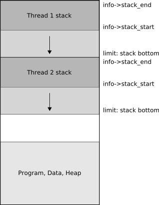
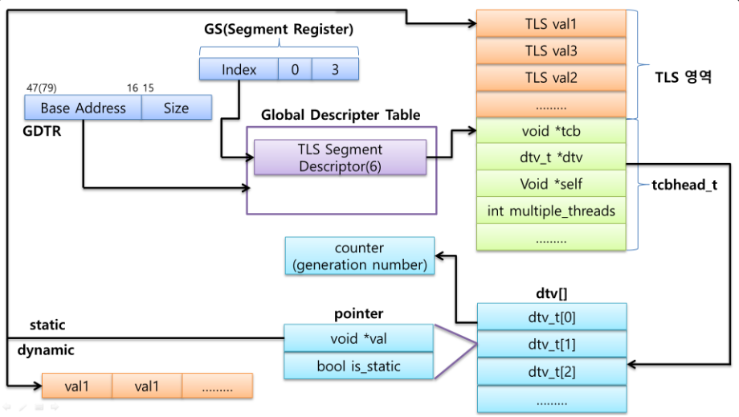
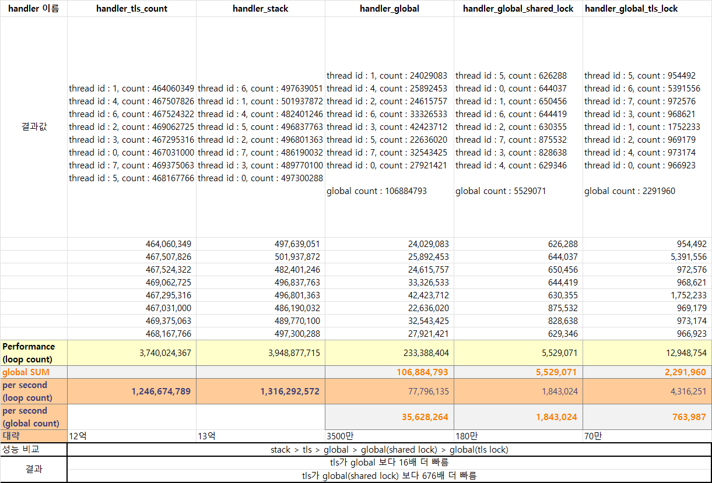
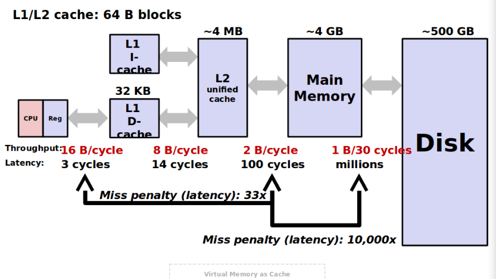
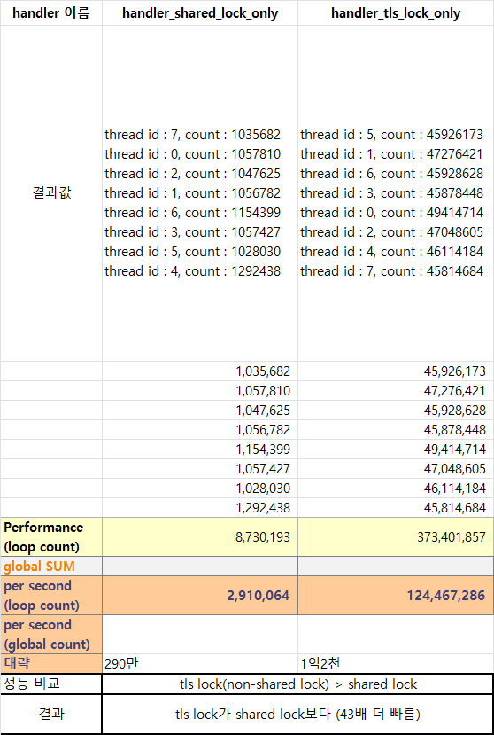

> ※  아래 내용은 스스로 공부한 내용을 정리한 글입니다.
> ※  때로 정확하지 않을 수 있으며, 참고만 부탁드립니다.
> ※  잘못된 내용이 있을시 댓글로 알려주시면 감사하겠습니다.

## 테스트 조건

8개의 멀티 스레드를 띄우고, 3초간 while 루프 안에서 count++ 하도록 함.

단, 모든 스레드가 완전히 띄워졌을 때 루프를 시작해야 한다.

## 비교 케이스

- local 변수 카운팅
- tls 변수 카운팅
- global 변수 카운팅
- global 변수 mutex lock 사용 시 카운팅

**1. local 변수**

local 변수는 stack에 저장된다. 그리고 스레드끼리는 stack을 공유하지 않는다.



*출처 https://www.mono-project.com/docs/advanced/garbage-collector/sgen/*

위 그림처럼, 스레드마다 stack 크기가 지정되므로 스레드끼리 독립적인 메모리 주소를 갖게 된다.

**2. TLS 변수**

TLS는 Thread Local Storage로, 각 스레드 별로 다른 값을 가지는 전역 변수를 말한다.

```cpp
// .tbss section
__thread int val1;

// .tdata section
__thread int val2 = 0;
```

TLS는 스레드 제어 블록(TCB) 또는 스레드 로컬 저장소 세크먼트라고 하는 메모리 공간의 특정 영역에 위치한다.

메모리 공간 내에서 TLS 메모리의 정확한 위치는 운영 체제과 TLS 특정 구현에 따라 다를 수 있다. 일반적으로는 두 가지 접근 방식이 있다.

2.1) 세그먼트 기반 TLS : TLS 메모리가 각 스레드 전용 메모리의 별도 세그먼트에 저장된다. 세그먼트는 운영 체제에서 관리하며, 각 스레드가 생성될 때 할당된다. 세그먼트는 일반적으로 스레드 메모리의 기본 주소를 가리키는 세그먼트 레지스터를 통해 참조된다.

2.2) 오프셋 기반 TLS : TLS 메모리에 액세스 하기 위해 메모리의 잘 알려진 위치에서 고정된 오프셋을 사용한다. 오프셋은 일반적으로 FS(32 비트 x86용) 또는 GS(64비트 x86용) 세그먼트 레지스터와 같은 레지스터에 저장된다. 레지스터에는 TLS 메모리의 기본 주소가 포함되어 있으며 TLS 변수는 기본 주소에 오프셋을 추가하여 액세스 한다.

내가 사용 중인 CensOS 8에서는, 일반적으로 오프셋 기반 TLS 모델을 사용한다.



*운영체제에서 TLS를 찾아가는 과정*

운영 체제가 TLS를 찾아가는 과정에 대한 내용은 세그먼트 레지스터에 대한 게시글에서 확인해 보자.

중요한 것은 각 스레드마다 TLS 변수의 메모리 주소값을 각기 다르게 가지고 있다는 점이다.

스레드끼리 TLS 변수를 절대 공유하지 않는다.

**3. global 변수**

global 변수는 초기화되지 않은 값이라면 bss (block started by symbol) 영역에, 초기화된 값이라면 data 영역에 저장된다. bss 영역과 data 영역은 메인 함수 전에 선언되어 프로그램이 끝날 때까지 메모리에 남아있는 변수다.

```cpp
// bss 영역
int global1;

// data 영역
int global2 = 2;
```

해당 영역은 모든 스레드에서 메모리 주소를 공유한다. thread 1이 이미 global1에 접근해서 값을 수정하고 있을 때, thread2가 접근하게 되면 자원 경쟁이 발생한다.

**4. global 변수 mutex lock (상호 배제) 사용**

그렇다면 자원 경쟁이 발생하지 않도록 mutex lock을 걸어서, 한 스레드가 접근 중일 때 다른 스레드가 값을 수정하지 못하도록 막아준다면 어떻게 될까? stack 변수나 TLS 변수와 달리 스레드가 차례로 접근해야 하기 때문에 속도가 느려지지 않을까?

## 결과


변수마다 handler를 만들어서 비교해 보았다. 3초 동안 루프를 돌려 변수에 얼마나 접근하는지 카운팅 하여 그 횟수를 더해보았다.

TLS, Stack 변수의 카운트는 한 스레드가 1초에 1.5번 정도 접근하여, 모든 스레드가 1초당 12억~13억 정도 접근하는 것을 관찰했다.

global 변수는 어떠할까. 모든 스레드가 1초에 3500만 번 밖에 접근하지 못했다. 그럼 global 변수에 shared lock을 걸게 되면, 자원 경쟁이 막아지므로 성능이 더 좋아지지 않을까? 하지만 예상외로, 모든 스레드가 1초에 180만 번 밖에 접근하지 못했다.

## 다시 한번 결과를 보자



카운트 값을 비교했을 때 성능 순으로 나열해 보면, stack &gt; tls &gt; global &gt; global (shared lock) 순인 것을 볼 수 있다.

그 이유는 메모리 주소의 공유에 있다. stack과 tls는 각 스레드마다 각기 다른 메모리 주소를 갖는다고 했다.

따라서 모든 스레드가 동시에 해당 변수의 값을 수정해도, 서로 다른 메모리 주소를 바라보고 있기 때문에 자원 경쟁과 병목 현상이 발생하지 않는다.

global 변수는 이와 반대로 메모리 주소를 공유하므로 스레드끼리 병목 현상이 발생하게 되어 성능이 무려 16배나 느려지게 되는 것이다. 게다가 서로 값을 변경하려고 하기 때문에, global 변수의 값이 프로그래머의 의도대로 만들어지지 않을 가능성이 아주 높다.

### local 변수와 TLS 변수에서, 왜 12 ~ 13억 번이나 카운팅 할 수 있었던 걸까?

```cpp
cat /proc/cpuinfo
```

CPU 정보를 보자. 내가 사용하고 있는 CPU를 기준으로, 2.20 GHz라는 값을 확인할 수 있다. 이는 내가 사용 중인 CPU의 clock이 2.2 GHz 번 움직인다는 의미다. 2.2G면 22억 번이다.

위의 엑셀표를 보면 하나의 스레드 당 1초에 1.x억 번 정도 돌았던 것을 볼 수 있다. 최고의 성능을 낸다면 1초에 22억 번 카운팅을 할 수 있다. 정말 간결한 루프 프로그램을 짜면 이 22억 번의 CPU clock에 준할 만큼의 속도가 나와야 한다.

내가 짠 프로그램은 1.x억 번 밖에 나오지 않아 무언가 성능을 떨어트리고 있는 원인자가 있을 테지만, 대강 "억" 단위라는 것에 주목을 하자.

참고로 요즘 CPU는 super scalar 아키텍처, super pipeline 아키텍처, 병렬 실행 유닛, 등등 온갖 고도화된 구조로 인해 1 clock에도 여러 명령어 (assembly 1 개 정도로 생각)를 처리할 수 있다.

### CPU H/W 와 관련된 global 변수 성능 저하의 이유



*출처&nbsp;https://talkingaboutme.tistory.com/entry/Memory-Virtual-memory-caches*

CPU H/W를 보면,

가장 빠른 메모리 : CPU 속 Register

그 다음 빠른 메모리 : L1 Cache

그다음 : L2 Cache

그다음 : L3 Cache

그다음 : 메모리

순으로 계층 구조를 가진다. 빠른 메모리일수록 가격이 압도적으로 비싸져서 용량을 매우 적게 가져간다.

그림을 보면, Register는 3 cycle 만에 접근이 되고, 1 GHz면 1 Cycle 1ns 이므로 3ns 만에 접근이 가능하다. 내가 사용 중인 CPU는 대략 2 GHz CPU를 쓰니, 0.5ns * 3 = 1.5ns 만에 접근이 가능하다.

L1 Cache가 그다음으로 빠른데 14 Cycle이 걸리고 메모리는 100 Cycle이나 걸린다.

global 변수는 모든 스레드가 같은 메모리 주소값을 공유한다. 어떤 메모리를 접근하던 간에 Register로 일단 값을 읽는다. 그러면서 Cache에 값을 저장한다. 그럼 처음 global 값을 ++할 때는 메모리에서 읽어서 Register에 쓰고 L1 에도 쓴다.

맨 처음 스레드가 global에 접근하고 난 뒤, 다음 두 번째부터 ++를 할 때는 Register만 ++하면 되는데, coherency를 관장하는 녀석이 같은 주소에 동시에 접근하는 것을 알아채고, 거리가 먼 메모리보다는 가까운 L1에 Cache Invalidation을 날린다. 그 이유는 CPU1이 ++해서 1에서 2로 바꾸었는데, CPU1이 1에서 다시 ++하게 되면 의도와 다른 값이 만들어지기 때문이다. 그래서 값을 다시 읽어오라는 의미로 Cache Invalidaion을 시켜버린다. 이런 과정이 모든 스레드가 접근할 때마다 무한 반복해서 일어난다.

물론 값을 Read 할 때는 상관이 없다. 이 이야기는 여러 스레드가 같은 메모리 주소에 Writing Operation 할 때의 이야기다.

이런 식으로 성능이 10배, 100배까지 떨어지게 되는 것이다. global 변수의 16배 성능 저하의 이유는 여기에 있다.

### global 변수에 Mutex lock을 걸어서 cache invalidation만 막으면 되는 걸까?

Mutex lock은 성능이 좋을까?

- Shared Mutex lock 사용 시 카운팅
- Non-Shared Mutex lock 사용 시 카운팅



표를 보면, Mutex lock의 성능이 굉장히 떨어진다.

모든 스레드가 공유해야 하는 Mutex lock을 사용하여, 특정 변수를 놓고 얼마나 카운팅 하는지 관찰해 본 결과, 1초당 290만 번 카운팅 되는 것을 알 수 있었다. 이는 공유하지 않는 lock의 카운트 값인 1억 2천만 번 보다, 43배 더 느린 것을 관찰할 수 있었다. 게다가 TLS 변수에 비해서는 676배나 느려지는 것을 볼 수 있다. 성능이 매우 안 좋다는 말이다.

Mutex lock operation 자체가 무거운 녀석이다. 그래서 함부로 쓰기에는 부담스러울 수 있다.

모든 스레드가 접근해야 하는 변수를 만들 때, TLS 변수를 사용하냐, global 변수에 lock을 걸어서 사용하냐는 다양한 상황을 고려해야 하는 프로그래머의 몫이다.

---

#### 코드 전문

```bash
#include <stdio.h>
#include <pthread.h>
#include <stdlib.h>
#include <string.h>
#include <stdint.h>

#define MAX_THREADS 16

int isReady[MAX_THREADS] = {0, };
int isStart = 0;
int isTerm = 0;
pthread_mutex_t shared_lock;
__thread pthread_mutex_t tls_lock;
__thread int tls_count = 0;
int global = 0;
 
// local stack variable sum
// shared global variable sum
// tls global variable sum
// tls mutex sum
// global mutex sum

int handler_shared_lock_only(void *data);
int handler_tls_lock_only(void *data);
int handler_tls_count(void *data);
int handler_stack(void *data);
int handler_global(void *data);
int handler_global_shared_lock(void *data);
int handler_global_tls_lock(void *data); 
int check_thread_all_ready(int thread_num);

int handler_shared_lock_only(void *data)
{
    printf("handler_shared_lock_only\n");
    int thread_id = (int)data;
    int i = 0;
    int stack = 0;
    pid_t pid;
    pthread_t tid;
    pid = getpid();
    tid = pthread_self();
    int local_count = 0;

    printf("thread id : %d, tid : %x, pid : %u\n", thread_id, (unsigned int)tid, (unsigned int)pid);

    isReady[thread_id] = 1;

    // wait start
    while(!isStart){};
    
    // wait until finish
    while(!isTerm) {
        pthread_mutex_lock(&shared_lock);
        pthread_mutex_unlock(&shared_lock);
        local_count++;
    }

    printf("thread id : %d, count : %d\n", thread_id, local_count);

    return 0;
}

int handler_tls_lock_only(void *data)
{
    printf("handler_tls_lock_only\n");
    int thread_id = (int)data;
    int i = 0;
    int stack = 0;
    pid_t pid;
    pthread_t tid;
    pid = getpid();
    tid = pthread_self();
    int local_count = 0;

    printf("thread id : %d, tid : %x, pid : %u\n", thread_id, (unsigned int)tid, (unsigned int)pid);

    isReady[thread_id] = 1;

    // wait start
    while(!isStart){};
    
    // wait until finish
    while(!isTerm) {
        pthread_mutex_lock(&tls_lock);
        pthread_mutex_unlock(&tls_lock);
        local_count++;
    }

    printf("thread id : %d, count : %d\n", thread_id, local_count);

    return 0;
}

int handler_tls_count(void *data)
{
    printf("handler_tls_count\n");
    int thread_id = (int)data;
    int i = 0;
    int stack = 0;
    pid_t pid;
    pthread_t tid;
    pid = getpid();
    tid = pthread_self();
    int local_count = 0;

    printf("thread id : %d, tid : %x, pid : %u\n", thread_id, (unsigned int)tid, (unsigned int)pid);

    isReady[thread_id] = 1;

    // wait start
    while(!isStart){};
    
    // wait until finish
    while(!isTerm) {
        tls_count++;
        local_count++;
    }

    printf("thread id : %d, count : %d\n", thread_id, local_count);

    return 0;
}

int handler_stack(void *data)
{
    printf("handler_stack\n");
    int thread_id = (int)data;
    int i = 0;
    int stack = 0;
    pid_t pid;
    pthread_t tid;
    pid = getpid();
    tid = pthread_self();
    uint64_t local_count = 0;

    printf("thread id : %d, tid : %x, pid : %u\n", thread_id, (unsigned int)tid, (unsigned int)pid);

    isReady[thread_id] = 1;

    // wait start
    while(!isStart){};
    
    // wait until finish
    while(!isTerm) {
        local_count++;
    }

    printf("thread id : %d, count : %lu\n", thread_id, local_count);

    return 0;
}

int handler_global(void *data)
{
    printf("handler_global\n");
    int thread_id = (int)data;
    int i = 0;
    int stack = 0;
    pid_t pid;
    pthread_t tid;
    pid = getpid();
    tid = pthread_self();
    uint64_t local_count = 0;

    printf("thread id : %d, tid : %x, pid : %u\n", thread_id, (unsigned int)tid, (unsigned int)pid);

    isReady[thread_id] = 1;

    // wait start
    while(!isStart){};
    
    // wait until finish
    while(!isTerm) {
        global++;
        local_count++;
    }

    printf("thread id : %d, count : %lu\n", thread_id, local_count);

    return 0;
}

int handler_global_shared_lock(void *data)
{
    printf("handler_global_shared_lock\n");
    int thread_id = (int)data;
    int i = 0;
    int stack = 0;
    pid_t pid;
    pthread_t tid;
    pid = getpid();
    tid = pthread_self();
    uint64_t local_count = 0;

    printf("thread id : %d, tid : %x, pid : %u\n", thread_id, (unsigned int)tid, (unsigned int)pid);

    isReady[thread_id] = 1;

    // wait start
    while(!isStart){};
    
    // wait until finish
    while(!isTerm) {
        pthread_mutex_lock(&shared_lock);
        global++;
        pthread_mutex_unlock(&shared_lock);
        local_count++;
    }

    printf("thread id : %d, count : %lu\n", thread_id, local_count);

    return 0;
}

int handler_global_tls_lock(void *data)
{
    printf("handler_global_tls_lock\n");
    int thread_id = (int)data;
    int i = 0;
    int stack = 0;
    pid_t pid;
    pthread_t tid;
    pid = getpid();
    tid = pthread_self();
    uint64_t local_count = 0;

    printf("thread id : %d, tid : %x, pid : %u\n", thread_id, (unsigned int)tid, (unsigned int)pid);

    isReady[thread_id] = 1;

    // wait start
    while(!isStart){};
    
    // wait until finish
    while(!isTerm) {
        pthread_mutex_lock(&tls_lock);
        global++;
        pthread_mutex_unlock(&tls_lock);
        local_count++;
    }

    printf("thread id : %d, count : %lu\n", thread_id, local_count);

    return 0;
}

int check_thread_all_ready(int thread_num)
{
    int i;
    for ( i = 0; i < thread_num; i++ )
    {
        if (isReady[i] == 0)
            return 0;
    }

    return 1;
}

int main(void)
{
    int i;
    int thread_num = 8;
    pthread_t pthread[thread_num];
    void *status;

    for (i = 0; i < thread_num; i++) {
        if (pthread_create(&pthread[i], NULL, handler_shared_lock_only, (void*)i) < 0) {
            printf("pthread create failed ( thread : %d )\n", i);
            exit(1);
        }
    }

    // wait all thread are ready
    while(1) {
        if (check_thread_all_ready(thread_num))
            break;
    }
    printf("now all threads are ready, so start!!!\n");

    isStart = 1;
    sleep(1);
    isTerm = 1;

    sleep(3);

    /*
    for (i = 0; i < thread_num; i++) {
        pthread_join(pthread[i], &status);
    }
    */

    printf("global count : %lu\n", global);
    printf("END\n");
    sleep(10);
    return 0;
}
```

컴파일 & 실행

```bash
gcc -o thread.out test.c -lpthread
./thread.out
```

---

참고하면 좋은 글

<https://talkingaboutme.tistory.com/entry/Memory-Virtual-memory-caches>

<https://thsd-stjd.tistory.com/149>

<https://tribal1012.tistory.com/157>
