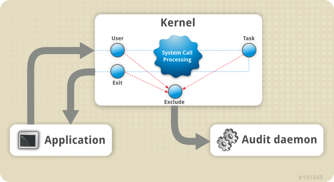
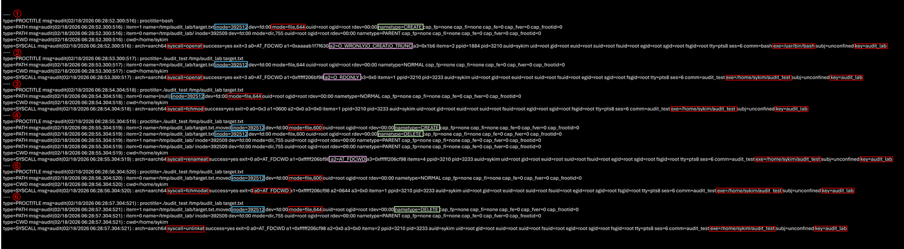

*Audit System Architecture (출처: RedHat)*

### 1. auditd 란?

auditd (Audit Daemon) 는 Linux 시스템의 보안 감사 데몬이다. 리눅스 시스템에서 발생하는 다양한 보안 관련 이벤트를 기록하고 모니터링한다.

auditd는 Linux Auditing System의 사용자 공간(userspace)의 구성 요소로, 감사(audit) 기록을 디스크에 저장하는 역할을 한다.
감사 로그를 조회할 때는 ausearch 또는 aureport 유틸리티를 사용한다.
감사 시스템을 설정하거나(rule 설정), 커널에 룰을 로드하는 작업은 auditctl 유틸리티로 수행한다.

시스템 부팅 시에는 /etc/audit/audit.rules 파일에 정의된 규칙들이 auditctl에 의해 읽혀지고, 커널에 로드된다.
auditd 데몬 자체에도 관리자가 설정할 수 있는 여러 설정 옵션들이 있고, 이 설정들은 auditd.conf 파일에 정의할 수 있다.

### 2. 사용 배경

리눅스 엔드포인트 백신 제품의 특정 기능을 활성화한 이후 파일 권한(permission)이 변경되는 현상이 있다는  문의가 접수되었다.

하지만 해당 기능에는 파일의 소유권(chown), 권한(chmod) 등을 변경하는 로직은 존재하지 않기에 누가 언제 어떤 syscall로 해당 파일의 권한을 변경했는지 확인하는 과정이 필요했다.

리눅스에서 파일 메타데이터 변경은 chmod(), fchmod(), fchmodat(), chown(), fchown(), fchownat(), setxattr() 과 같은 system call을 통해 수행된다.

이러한 system call은 커널 레벨에서 처리되고 Linux Audit Subsystem이 해당 syscall 이벤트를 캡처할 수 있다. 그리고 auditd는 netlink를 통해 해당 이벤트를 전달받아 로그로 기록한다.

따라서 파일 권한을 변경하는 주체를 정확하게 식별해내기 위해, 커널 레벨에서 system call을 추적할 수 있는 auditd를 활용했다.

### 3. 사용 방법

#### 3-1. auditctl

audit (감사) 시스템을 제어하는 명령줄 유틸리티다.
auditctl 유틸리티를 사용해서 CLI 상 또는 /etc/audit/rules.d/ 의 디렉터리의 audit 규칙을 설정할 수 있다.

주요 명령어는 다음과 같다.

auditctl -l 현재규칙 확인
auditctl -s audit 상태 확인
auditctl -D 모든 규칙 삭제
auditctl -w {감시할 파일 또는 디렉터리 경로} -p {권한 문자 조합} -k {검색용 키워드 또는 식별자}

예를 들어, 아래와 같이 옵션을 조합해 audit 룰을 작성할 수 있다.
auditctl -a {행동,기록시점} -F arch={아키텍처} -S {감시할 시스템콜} -F uid={사용자 ID} -k {검색용 키워드}
auditctl -w {감시할 파일 또는 디렉터리 경로} -p {r|w|x|a 권한 문자 조합} -k {검색용 키워드}

| **옵션** | **전달 정보** |
| --- | --- |
| **-w** | 감시할 파일 또는디렉터리 경로 |
| **-p** | **권한 문자**r (read)w (write)x (execute)  a (attribute change) 삭제, 이름변경, 권한변경 등 메타데이터 변동이 포함되는 케이스가 많아서 실습에 유리 |
| **-a** | **기록 방식**-a action,list 지정-a { always | never },{ entry | exit | task | user | exclude }**action에 들어갈 수 있는 것들**always ( 조건 일치 시 항상 기록 )never ( 조건 일치 시 기록하지 않음 )**list에 들어갈 수 있는 것들**entry ( syscall 진입 시점 )exit ( syscall 종료 시점 )task ( 프로세스 생성 시점 감시 ) user ( user-space 이벤트 필터링 )exclude ( 특정 이벤트 타입 제외 ) |
| **-S** | 시스템 콜-S 필터에 들어갈 수 있는 것들-S execve-S openat-S unlink-S chmod-S setuid |
| **-F** | 조건 필터-F 필터에 들어갈수 있는 것들-F uid={사용자ID}-F euid={유효UID}-F gid={그룹ID}-F pid={프로세스ID}-F dir={디렉토리}-F success={0 또는 1} |
| **-k** | 검색 태그-k wanggonya_test-k wanggonya_permission_test |

#### 3-2. ausearch

ausearch는 audit.log에서 조건 기반으로 이벤트를 검색하는 도구다.
raw 이벤트를 그대로 보여주는데, -i 옵션을 사용하는 것이 매우 유용하다.

audit 로그는 기본적으로 raw 형태로 기록되기 때문에, 아래와 같은 audit 로그를 바 해석하기에 어려움이 따른다.

```bash
type=SYSCALL msg=audit(1718945552.123:456): 
arch=c00000b7 syscall=90 success=yes exit=0 
a0=7ffd1234 a1=1ff a2=0 a3=0 items=1 ppid=1234 pid=5678 
auid=1000 uid=1000 gid=1000 euid=1000 ...
```

arch=c00000b7 는 ARM64 아키텍처 코드를 의미하고, syscall=90는 syscall 번호, uid=1000는 UID 숫자를 의미하고 있다.
이러한 로그는 바로 해석해서 분석하기에 어려움이 따른다.

그러나 -i (interpret) 옵션을 사용하면 위와 같은 숫자값을 사람이 읽을 수 있는 형태로 변환해준다.

```bash
type=SYSCALL msg=audit(2024-06-21 10:12:32.123:456): 
arch=aarch64 syscall=chmod success=yes exit=success 
a0=0x7ffd1234 a1=0777 a2=0 a3=0 items=1 
ppid=1234 pid=5678 
auid=sykim uid=sykim gid=sykim euid=sykim ...
```

위 로그를 raw 로그와 비교해보자. syscall도 숫자가 아닌 chmod를 호출했음을 바로 보여주고 있고,
uid 또한 숫자가 아닌 문자열로 보여주며 어떤 사용자가 해당 행위를 발생시켰는지 보여주고 있다.

#### 3-3. aureport

aureport는 audit.log를 통계 리포트 형태로 보여주는 도구다. 통계와 요약 위주의 리포트 생성 도구로서 ausearch와는 목적이 다르다. 누가 가장 많이 접근했는지, 어떤 syscall이 가장 많이 호출 되었는지, 실패한 이벤트가 무엇인지, 어떤 파일이 많이 접근되었는지를 통계 형태로 출력한다.

따라서 특정 파일에 대한 audit log를 분석해야 할 때에는 aureport보다 ausearch가 더 적합할 수 있다.

### 4. 사용 예시

#### 4-1. audit rule 일시적으로 생성

1) 일시적으로 audit rule을 아래와 같이 등록한다.
sudo auditctl -w /tmp/audit_lab -p rwxa -k audit_lab

2)  audit 룰 조회
sudo auditctl -l

```bash
# sudo auditctl -l
-w /tmp/audit_lab -p rwxa -k audit_lab
```

#### 4-2. 참고. 만약 audit rule을 영구적으로 등록하고 싶다면?

1) 아래와 같이 /etc/audit/rules.d 에 룰을 등록한다.
echo "-w /tmp/audit_lab -p rwxa -k audit_lab_permanent" | sudo tee /etc/audit/rules.d/audit_lab_permanent.rules

2) audit 룰 로드
sudo augenrules --load

3) auditd 재시작
sudo systemctl restart auditd

4) audit 룰 조회
sudo auditctl -l | grep audit_lab_permanent

```bash
# sudo auditctl -l | grep audit_lab
-w /tmp/audit_lab -p rwxa -k audit_lab_permanent
```

#### 4-3. 테스트 바이너리를 이용해 파일 이벤트 발생시키기

1) 테스트 코드를 빌드해주자.
gcc -O2 -Wall -Wextra -o audit_test audit_test.c

2) 테스트를 위해 디렉터리를 생성한다.
mkdir -p /tmp/audit_lab

3) 테스트 파일을 생성한다.
echo "hello auditd" &gt; /tmp/audit_lab/target.txt

4) 이제 테스트 바이너리를 이용해 테스트 파일에 파일 이벤트를 발생시킨다.
./audit_test   /tmp/audit_lab target.txt

```bash
# ./audit_test   /tmp/audit_lab target.txt                                                                                                                                                                      [ OK ]
[READ] /tmp/audit_lab/target.txt: "hello auditd
" (bytes=13)
[FCHMOD] /tmp/audit_lab/target.txt -> mode 0600
[MOVE] /tmp/audit_lab/target.txt -> /tmp/audit_lab/target.txt.moved
[CHMOD] /tmp/audit_lab/target.txt.moved -> mode 0644
[REMOVE] /tmp/audit_lab/target.txt.moved
```

#### 4-4. audit log 예시

아래 명령어를 통해 감사 로그를 확인할 수 있다.
분석 방법은 아래 **5. audit 로그 분석하기**에서 자세하게 확인해보자.
sudo ausearch -i -k audit_lab --start recent

```bash
# sudo ausearch -i -k audit_lab --start recent
----
type=PROCTITLE msg=audit(02/18/2026 06:28:52.300:516) : proctitle=bash
type=PATH msg=audit(02/18/2026 06:28:52.300:516) : item=1 name=/tmp/audit_lab/target.txt inode=392512 dev=fd:00 mode=file,644 ouid=root ogid=root rdev=00:00 nametype=CREATE cap_fp=none cap_fi=none cap_fe=0 cap_fver=0 cap_frootid=0
type=PATH msg=audit(02/18/2026 06:28:52.300:516) : item=0 name=/tmp/audit_lab/ inode=392509 dev=fd:00 mode=dir,755 ouid=root ogid=root rdev=00:00 nametype=PARENT cap_fp=none cap_fi=none cap_fe=0 cap_fver=0 cap_frootid=0
type=CWD msg=audit(02/18/2026 06:28:52.300:516) : cwd=/home/sykim
type=SYSCALL msg=audit(02/18/2026 06:28:52.300:516) : arch=aarch64 syscall=openat success=yes exit=3 a0=AT_FDCWD a1=0xaaaab1f7f630 a2=O_WRONLY|O_CREAT|O_TRUNC a3=0x1b6 items=2 ppid=1884 pid=3210 auid=sykim uid=root gid=root euid=root suid=root fsuid=root egid=root sgid=root fsgid=root tty=pts8 ses=6 comm=bash exe=/usr/bin/bash subj=unconfined key=audit_lab
----
...
...
// audit 로그 출력
```

aureport를 사용하면 아래와 같이 요약된 간단한 결과를 확인할 수도 있다.
sudo aureport -f --summary | head

```bash
# sudo aureport -f --summary | head

File Summary Report
===========================
total  file
===========================
3  /tmp/audit_lab/
2  /tmp/audit_lab/target.txt
2  /tmp/audit_lab/target.txt.moved
```

#### 4-5. 로그 초기화 ( 로그 로테이트 )

auditd는 자체 로테이션 메커니즘을 제공한다.
service auditd rotate

```bash
# sudo service auditd rotate
 * Rotating audit daemon logs auditd
```

```bash
# ls -l /var/log/audit/audit.log.1
-r--r----- 1 root adm 107474 Feb 18 06:00 /var/log/audit/audit.log.1
```

### 5. audit 로그 분석하기

아래 audit 로그에는 echo를 통한 테스트 파일 생성부터,
테스트 바이너리 ( ./audit_test )를 통한 5개의 파일 이벤트를 확인할 수 있다.



이 6개의 audit 로그에는 target.txt 파일의 라이프사이클이 기록되어 있다.
**①** **CREATE →** **②** **READ →** **③** **PERMISSION CHANGE →** **④** **RENAME →** **⑤** **PERMISSION CHANGE →** ⑥ **DELETE**

하나의 파일 이벤트는 단일 로그가 아니라 SYSCALL, PATH, CWD 등 여러 record의 집합으로 구성된다.
msg=audit(timestamp:ID) 값이 동일한 레코드들을 하나의 이벤트로 묶어 해석해야 한다.

① /tmp/audit_lab/target.txt 생성 또는 덮어쓰기

파일 객체가 생성된 시점이다.

파일 생성 + truncate 되며,
주요 필드인 syscall 에는 O_WRONLY | O_CREAT | O_TRUNC,
nametype에는 CREATE,
mode=644 로서

파일이 없으면 생성, 있으면 기존 내용 삭제, mode=644로 생성되었음을 의미한다.

② target.txt 읽기 위해 open
단순한 파일 읽기 이벤트가 발생한 시점이다.

파일 읽기 동작이 일어나며
syscall은 openat 과 O_RDONLY ( Read Only )가 호출되고 있다.

단순한 READ 이벤트가 일어났음을 의미한다.

③ target.txt 권한 0600으로 변경

파일 권한이 644 에서 600으로 변경된 시점이다.

권한 변경 (FD 기반) 동작이 일어나며,
syscall은 fchmod 가 호출되고 있다.
mode=0600 으로 파일 권한 모드가 변경되었음을 의미한다.

FD 기반 syscall의 경우 PATH record에 name=(null)로 나타날 수 있으며,
inode를 통해 동일 객체임을 확인해야 한다.

파일 권한이 644 -&gt; 600 변경되었음을 의미한다.
fchmod가 발생한 후 바로 다음에 저장된 audit 로그를 보면 mode가 600으로 변경된 것을 볼 수 있다.

④ target.txt → target.txt.moved 파일 경로(이름) 변경

파일 경로(이름)가 변경된 시점이다.

파일 이름 변경 (rename) 동작이 일어나며,
syscall은 renameat 가 호출되고 있다.
nametype에서 DELETE ( old name ) -&gt; CREATE ( new name ) 로그가 발생했다.

또한 inode는 그대로 유지되어 파일 객체가 동일하고
파일 이름만 변경되었음을 의미한다.

⑤ target.txt.moved 권한 0644로 변경
파일 권한이 600 에서 644로 다시 변경된 시점이다.

권한 재변경 동작이 일어나며,
syscall은 fchmodat 가 호출되고 있다.
mode=0644 로 파일 권한 모드가 변경되었음을 의미한다.

따라서 파일 권한이 600 -&gt; 644 변경되었음을 의미한다.
fchmodat가 발생한 후 바로 다음에 저장된 audit 로그를 보면 mode가 644로 변경된 것을 볼 수 있다.

⑥ target.txt.moved 삭제

파일 객체가 삭제된 시점이다.

파일 삭제 동작이 일어나며,
syscall은 unlinkat 가 호출되고 있다.

nametype은 DELETE로서 테스트 파일이 삭제되었음을 알 수 있다.

다른 필드에 대한 의미가 궁금하다면 아래 링크를 참고하자.

아래 링크에서는 audit 로그 내용에 대한 자세한 내용을 확인할 수 있다.
[11.5. 로그 파일 감사 이해 | 보안 강화 | Red Hat Enterprise Linux | 8 | Red Hat Documentation](https://docs.redhat.com/ko/documentation/red_hat_enterprise_linux/8/html/security_hardening/understanding-audit-log-files_auditing-the-system)

### 6. 참고. 테스트 코드 전문 ( audit_test.c )

**▼ 더보기**

```cpp
#define _GNU_SOURCE
#include <errno.h>
#include <fcntl.h>
#include <limits.h>
#include <stdio.h>
#include <stdlib.h>
#include <string.h>
#include <unistd.h>
#include <sys/stat.h>

static void die(const char *msg) {
    perror(msg);
    exit(EXIT_FAILURE);
}

static void join_path(char *out, size_t out_sz, const char *dir, const char *name) {
    size_t len = snprintf(out, out_sz, "%s/%s", dir, name);
    if (len >= out_sz) {
        fprintf(stderr, "Path too long\n");
        exit(EXIT_FAILURE);
    }
}

int main(int argc, char **argv) {
    if (argc != 3) {
        fprintf(stderr, "Usage: %s <test_dir> <filename>\n", argv[0]);
        return EXIT_FAILURE;
    }

    const char *test_dir = argv[1];
    const char *filename = argv[2];

    char src[PATH_MAX];
    char dst[PATH_MAX];

    join_path(src, sizeof(src), test_dir, filename);

    // dst = <test_dir>/<filename>.moved
    {
        char moved_name[NAME_MAX];
        int n = snprintf(moved_name, sizeof(moved_name), "%s.moved", filename);
        if (n < 0 || (size_t)n >= sizeof(moved_name)) {
            fprintf(stderr, "Moved filename too long\n");
            return EXIT_FAILURE;
        }
        join_path(dst, sizeof(dst), test_dir, moved_name);
    }

    sleep(1);
    // 1) open + read
    int fd = open(src, O_RDONLY);
    if (fd < 0) die("open(O_RDONLY)");

    char buf[128];
    ssize_t r = read(fd, buf, sizeof(buf) - 1);
    if (r < 0) die("read");
    buf[(r >= 0) ? r : 0] = '\0';

    printf("[READ] %s: \"%s\" (bytes=%zd)\n", src, buf, r);

    sleep(1);
    // 2) fchmod (FD 기반 권한 변경)
    if (fchmod(fd, 0600) < 0) die("fchmod(0600)");
    printf("[FCHMOD] %s -> mode 0600\n", src);

    if (close(fd) < 0) die("close");

    sleep(1);
    // 3) rename (move)
    if (rename(src, dst) < 0) die("rename(move)");
    printf("[MOVE] %s -> %s\n", src, dst);

    sleep(1);
    // 4) chmod (경로 기반 권한 변경)
    if (chmod(dst, 0644) < 0) die("chmod(0644)");
    printf("[CHMOD] %s -> mode 0644\n", dst);

    sleep(1);
    // 5) remove
    if (unlink(dst) < 0) die("unlink(remove)");
    printf("[REMOVE] %s\n", dst);

    return EXIT_SUCCESS;
}
```

### 7. 참고. 테스트 스크립트 전문 ( test.sh )

**▼ 더보기**

```bash
sudo service auditd rotate
echo "hello auditd" > /tmp/audit_lab/target.txt
./audit_test   /tmp/audit_lab target.txt
sudo ausearch -i -k audit_lab --start recent > test_audit_log.txt
vi test_audit_log.txt
```

### 8. 마치며

이번 실습에서 확인했듯이, 하나의 파일 동작은 단일 이벤트가 아니라 여러 시스템 콜의 조합으로 이루어진다. 생성, 읽기, 권한 변경, 이름 변경, 삭제와 같은 행위는 각각 별도의 syscall로 수행되며, audit 로그에는 SYSCALL, PATH, CWD 등의 record로 분리되어 기록된다. 따라서 동일한 audit ID를 기준으로 묶어 해석해야 실제 행위 흐름을 정확히 이해할 수 있다.

auditd의 의미는 단순한 로그 수집에 있지 않다. 커널 레벨에서 발생한 syscall을 기반으로 기록하기 때문에, 행위의 주체와 시점을 명확하게 확인할 수 있다. 파일 권한 변경이나 무결성 이슈와 같이 원인 규명이 필요한 상황에서 auditd는 가장 직접적이고 신뢰할 수 있는 분석 근거를 제공한다.

시스템 콜 수준에서 행위를 확인해야 하는 상황이라면, auditd를 활용해보는 것을 권장한다.

---

### [ Reference ]

[auditd(8) - Linux manual page](https://man7.org/linux/man-pages/man8/auditd.8.html)

[🔗 auditd(8) - Linux manual page](https://man7.org/linux/man-pages/man8/auditd.8.html)

[Chapter 7. System Auditing | Security Guide | Red Hat Enterprise Linux | 6 | Red Hat Documentation](https://docs.redhat.com/en/documentation/red_hat_enterprise_linux/6/html/security_guide/chap-system_auditing)

[🔗 Chapter 7. System Auditing | Security Guide | Red Hat Enterprise Linux | 6 | Red Hat Documentation](https://docs.redhat.com/en/documentation/red_hat_enterprise_linux/6/html/security_guide/chap-system_auditing)
