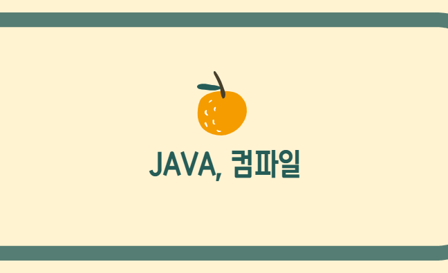

**자바**는 무엇일까? 객체 지향 프로그래밍 언어? 뛰어난 보안성?
우린 자바로 뭘 할 수 있을까?
자바를 이용하면 웹과 안드로이드에서 인디게임이나 포스기,
채팅기능 만들기가 가능하다.
그러기 위해서는 사람의 언어를 컴퓨터의 언어로 바꾸어주는 작업이 필요하다. 이것을 **컴파일**이라고 하며,
나는 **eclipse photon** 버전을 이용한다.

**컴파일의 과정**은
1. 디버그
2. 빌드
4. 링크
3. 실행 프로그램 이다.

디버그(오류 검사)를 진행하고
빌드를 통해 실행 프로그램을 만드는 작업을 한다.
링크는 실행 프로그램의 경로를 가지고 있다.

우리는 **OS(운영체제)**를 통해 하드웨어에 적절한 전기신호를 흘려준다.
사용자는 1+1 (RAM CPU RAM)의 명령을 운영체제에게 주고
적절한 응답을 받는다.

**RAM**, 즉 메모리는 어떻게 구성되어 있을까? 간단히 정리해보자.
- OS Kernel Space : 드라이버 (높은 주소)
- Stack : 지역변수, 매개변수
- Free : Stack과 Heap이 넘칠 수 있는 공간 (유동적),
Stack과 Heap이 만나면 Stack Overflow
- Heap : 동적 메모리 (new)
- Bss : 초기화되지 않은 변수
- Data 영역 : 전역 변수, stoic 변수
- Text : 상수 (낮은 주소)

운영체제가 바뀌면 자바라는 언어는 어떻게 되는 걸까?

다행히 **JVM(Java Virtual Machine)**이 운영체제가 아무리 바뀌어도 관리해주는 역할을 한다.
또한 자바 프로그램을 실행하며, 자바 고유의 환경을 구축하고, 하드웨어적이다.
JVM은 Class Loader(메모리 적재),
Runtime Data Areas(RAM 영역 관리),
Execution Engine(소스코드 읽고 실행)
이렇게 세 가지 영역으로 돌아간다.
Class Loader는 컴퓨터가 기억하고 있는 것을 불러오는 역할이며,
Execution Engine은 말 그대로 엔진을 실행한다.

자바의 환경을 조성하는 **JRE(Java Runtime Environment)**는 무엇일까.
JRE는 JVM을 생성하는 부분으로써 JVM에서 실행할 때 필요한
라이브러리 파일들과 기타 파일들을 가지고 있다.

**JDK(Java Development Kit)**는 내가 설치한 것이다.
JVM과 JRE에 의해 실행되고 구동될 수 있는
자바 프로그램을 생성할 수 있게 해 준다.
또한 JRE 외의 개발에 필요한 도구들을 가지고 있다.

다음에는 이클립스를 통해 자바를 시작해보자
