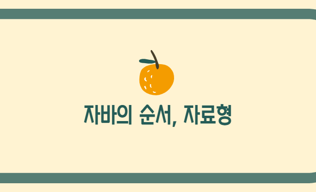
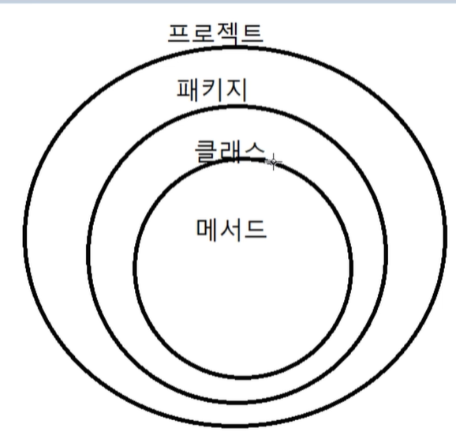

프로젝트를 만들고, 패키지를 만들고, 클래스를 만든다. 클래스 안에 우리가 입력하는 것이 메서드가 된다.

패키지의 이름은 대문자로, 클래스의 이름은 소문자로 시작하는 것이 개발자 간의 약속이다.

**콘솔**은 사용자와 운영체제간의 소통 결과를 나타내는 창이다.

**변수**는 저장공간의 개념이며 값은 저장공간에 담긴다.

**type(자료형)**은 저장공간의 종류다. 변수와 type이 맞아야 한다.

**자료형****type        byte        값**

논리형        **boolean**  1byte        true, false

정수형       **int**         4byte        0, 5, 9, 2100000000

(short, long보다 int가 가장 많이 쓰인다.)

실수형        **double**   8byte        10.0, 9.5, 2.0, 0.0

(float은 4byte이며 double이 많이 쓰인다.)

문자형        **char**       2byte        'a', 'b', 'c',...

문자열        **S****tring**       ???        "abc", "wanggo"

(첫 글자가 대문자일 것.)

여기서 **1byte**는 정보의 최소단위이다. (1byte는 2^8bit)

그렇다면 4byte가 가장 많이 쓰이는 이유는 무엇일까.

운영체제는 2^32bit, 2^64bit로 2^32bit는 최대 4byte이기 때문임?

4byte는 총 42억의 수를 넣을 수 있다.
