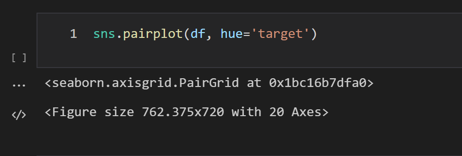
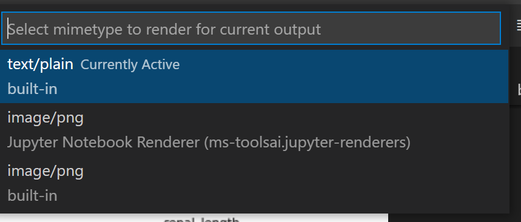
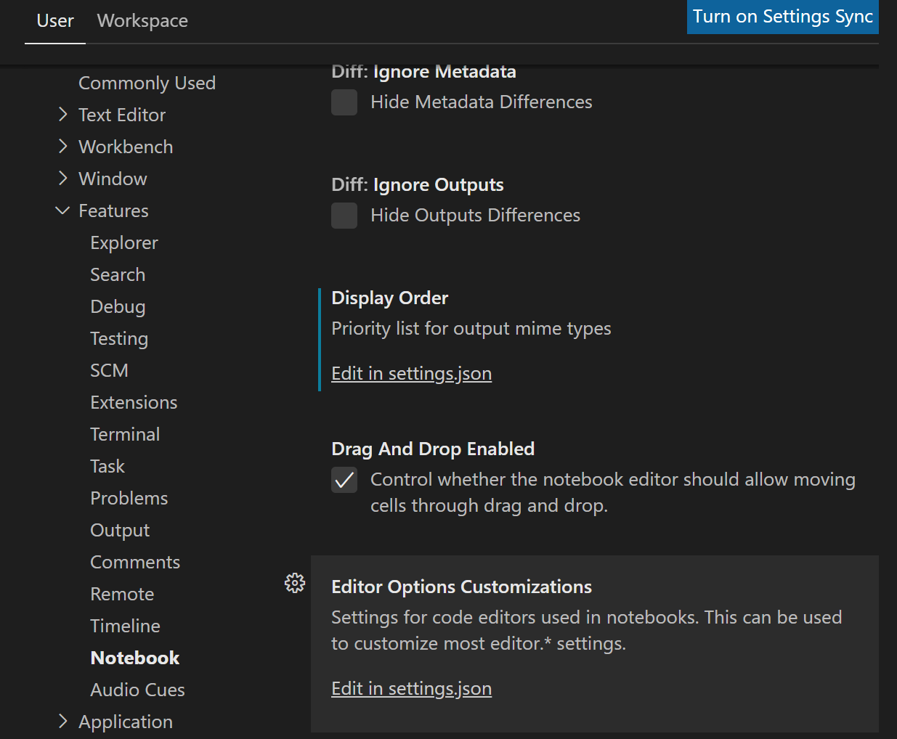
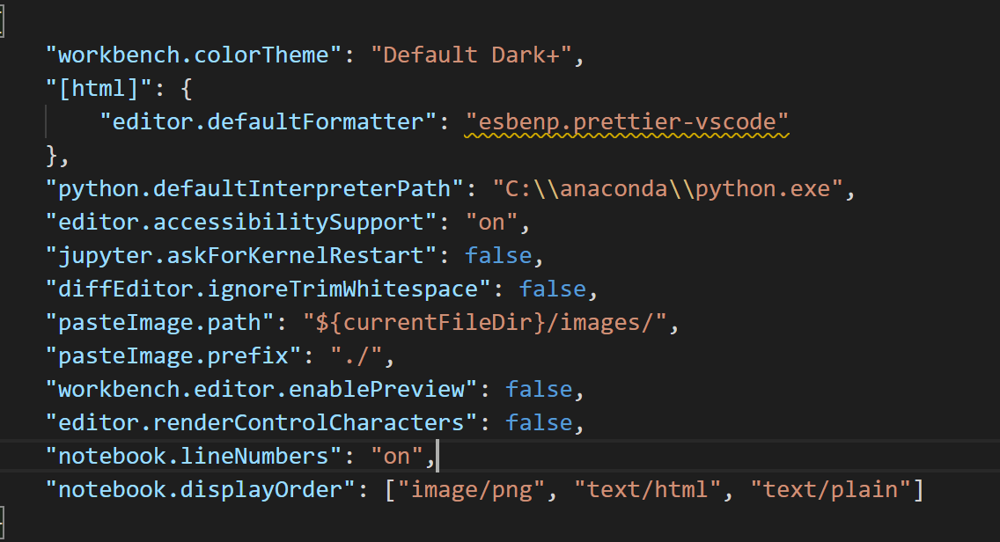
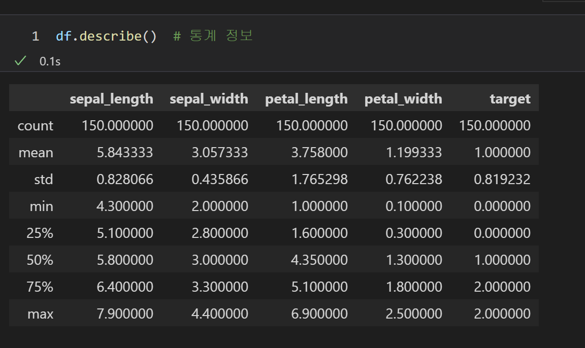
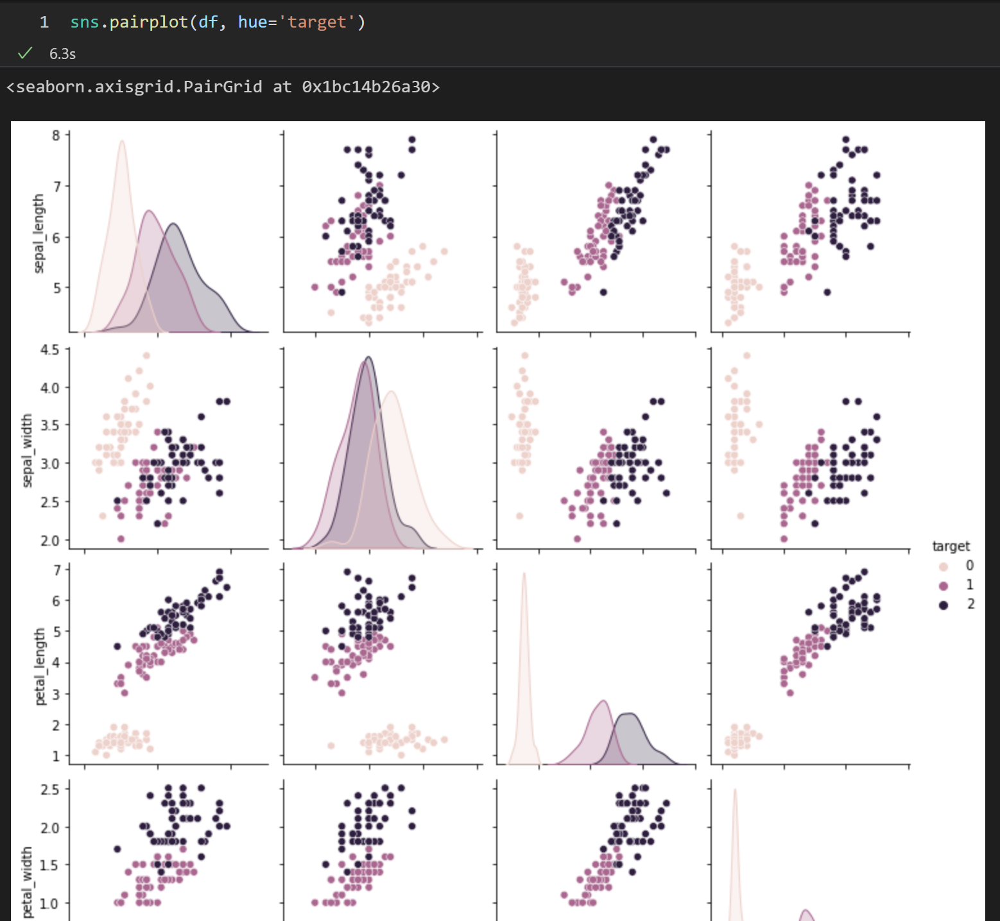

파이썬으로 데이터 분석 중 plot 이미지를 보려고 했으나 자꾸만 text 형식으로 출력된다...

내가 필요한 것은 데이터가 예쁘게 그려진 plot 이미지다.



*text로만 나오는 output*

output 왼편에... 또는 &lt;/&gt;를 누르면 change presentation이 나온다.



*change presentation을 누르면 상단에 뜨는 select 창*

**output의 형식**을 고를 수 있다.
**- text/plain** : 현재 text형식으로 나오는 output을 의미한다.
**- image/png** : 난 현재 주피터 노트북을 사용하고 있으므로 두 번째를 선택해준다.
- (세 번째 built-in은 두 번째와 무엇이 다른지 아직 모르겠음.)

이렇게 일일이 선택해주면 output에 plot이 그려지긴 하지만,
나는 ipynb 확장자를 통해 공부 중이고
따라서 각 cell별 output을 봐야 하기 때문에 일일이 누르고 있자니 피곤한 것이다!

따라서

### &lt; cell run시, 자동으로 plot image 나오게 하는 법 &gt;

**두둥**



**Settings -&gt; Features -&gt; Notebook -&gt; Editor Options Customizations**
**아래 Edit in settings.json 클릭**



**맨 아랫줄에**

```
"notebook.displayOrder": ["image/png", "text/plain"]
```

**추가해주자.**

여기까지 해도 상관없고,

나같은 경우엔

"image/png"와 "text/plain" 사이에 "text/html"을 추가했는데 이렇게 하면



*표 형식의 output*

이런 식으로 표 형식도 자동으로 바뀌어 출력된다.

이 코드의 의미는

" output이 혹시 이미지 형태로 나올 수 이써? 그럼 image로 고고 !!!

image가 아니야?? 그럼 text/html이야?? 그럼 표 형식으로 고고!!!

그것도 아냐?? 원래의 text/plain으로 출력할게~ "

라는 의미다.

다 적었으면
**윗줄에 쉼표, 맨 마지막 }으로 닫아줄 것!**

**오타 없는지 확인하고 완료했으면**

**저장해주자.**



자동으로 잘 나온다 ㅎㅎ

---

Reference :
[visual studio code - Change mimetype for VSC Jupyter Notebook ouput - Stack Overflow](https://stackoverflow.com/questions/68555264/change-mimetype-for-vsc-jupyter-notebook-ouput)

[🔗 Change mimetype for VSC Jupyter Notebook ouput](https://stackoverflow.com/questions/68555264/change-mimetype-for-vsc-jupyter-notebook-ouput)
