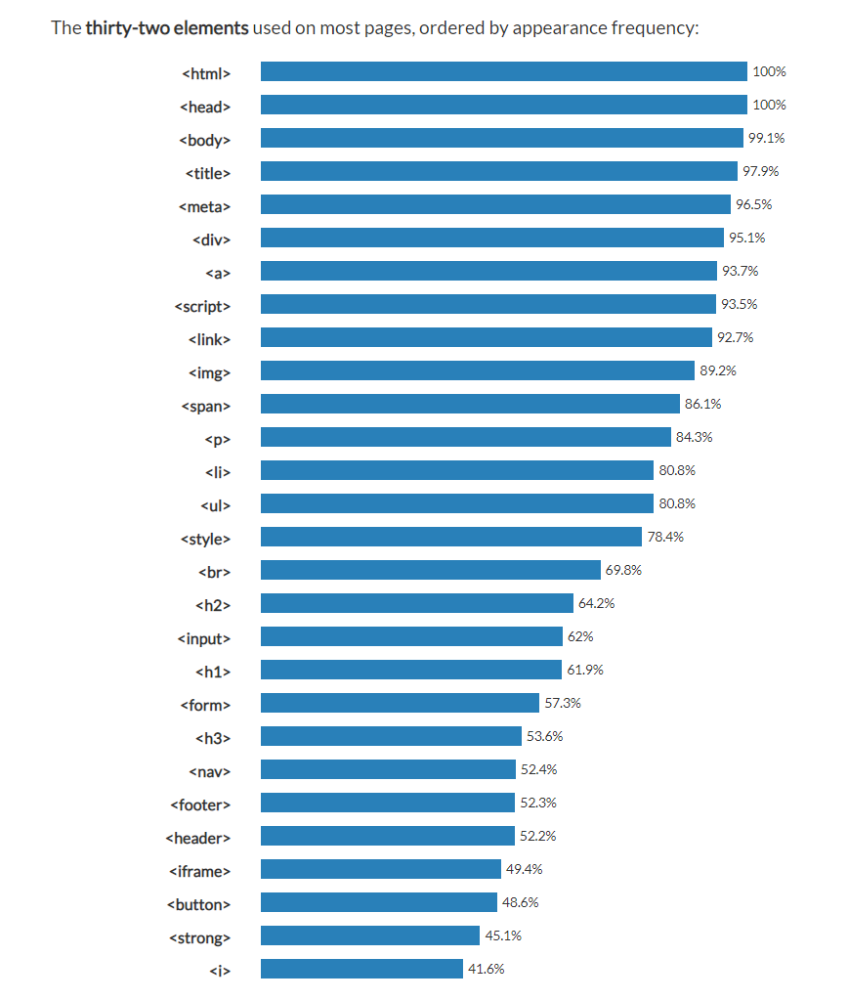
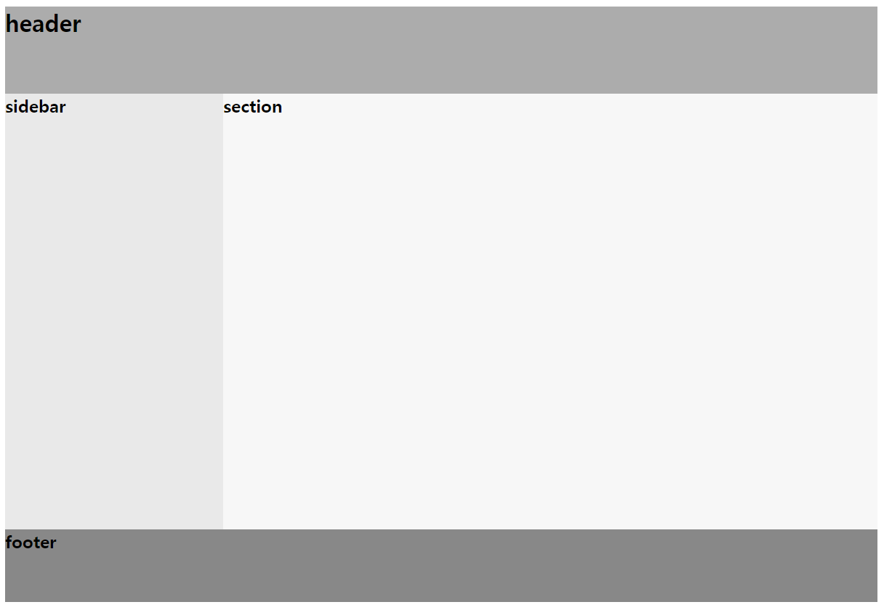

많이 쓰이는 HTML 태그를 기준으로 정리한 글이다.

*html 인기 태그 순위*

**reperence : <https://www.advancedwebranking.com/html/>**

---

**기본 태그**

&lt;html&gt;

&lt;head&gt;

&lt;body&gt;

&lt;title&gt;

&lt;meta&gt;

<table border="1" data-ke-align="alignLeft" data-ke-style="style7" style="border-collapse: collapse; width: 66.9767%; height: 220px;">
<tbody>
<tr>
<td colspan="2"><b>&lt;!DOCTYPE html&gt;</b></td>
<td><b>웹 문서의 유형을 html로 지정</b></td>
</tr>
<tr>
<td colspan="2"><b>&lt;html lang="언어"&gt;</b></td>
<td><b>문서를 html로 시작, 언어 지정 ex&gt; en, ko 등</b></td>
</tr>
<tr>
<td rowspan="3"><b>&lt;head&gt;</b></td>
<td colspan="2"><b>주로 브라우저의 정보를 입력하는 곳</b></td>
</tr>
<tr>
<td><b>&lt;meta&gt;</b></td>
<td><b>메타 데이터 입력, 주로 &lt;meta charset="UTF-8"&gt;처럼 입력</b></td>
</tr>
<tr>
<td><b>&lt;title&gt;</b></td>
<td><b>문서 제목</b></td>
</tr>
<tr>
<td><b>&lt;body&gt;</b></td>
<td colspan="2"><b>문서 내용을 입력</b></td>
</tr>
</tbody>
</table>

---

**문서 구조 태그**

&lt;div&gt;

&lt;span&gt;

&lt;nav&gt;

&lt;footer&gt;

&lt;header&gt;

| **&lt;header&gt;** | **헤더 영역** |
| --- | --- |
| &lt;main&gt; | 메인 영역 |
| &lt;section&gt; | 콘텐츠 영역 |
| &lt;aside&gt; | 사이드 바 영역 |
| **&lt;footer&gt;** | **푸터 영역** |

| **&lt;nav&gt;** | **내비게이션 영역,****문서 내 다른 위치, 다른 문서로 연결할 때 사용** |
| --- | --- |
| &lt;article&gt; | 독립적인 콘텐츠를 사용할 때 |
| &lt;section&gt; | 콘텐츠 영역 |
| **&lt;div&gt;** | **여러 소스 묶기,****어떤 의미도 없는 무색 무취의 태그, 화면 전체 사용, 줄바꿈 됨** |
| **&lt;span&gt;** | **div와 같지만 화면 전체 사용X, 줄바꿈 안 됨** |

---

**하이퍼 링크 삽입**

&lt;a&gt;

<table border="1" data-ke-align="alignLeft" data-ke-style="style5" style="border-collapse: collapse; width: 66.9767%; height: 59px;">
<tbody>
<tr>
<td rowspan="4"><b>&lt;a&gt;</b></td>
<td colspan="2">하이퍼 링크 삽입</td>
</tr>
<tr>
<td>href=</td>
<td>링크 주소</td>
</tr>
<tr>
<td>target="_blank"</td>
<td>새 탭에서 열기</td>
</tr>
<tr>
<td>title=</td>
<td>페이지 설명 추가</td>
</tr>
</tbody>
</table>

---

**이미지 삽입**

&lt;img&gt;

<table border="1" data-ke-align="alignLeft" data-ke-style="style5" style="border-collapse: collapse; width: 66.8605%; height: 122px;">
<tbody>
<tr>
<td rowspan="6"><b>&lt;img&gt;</b></td>
<td colspan="3">이미지 삽입</td>
</tr>
<tr>
<td>src=</td>
<td colspan="2">이미지 파일 경로</td>
</tr>
<tr>
<td>alt=</td>
<td colspan="2">대체용 텍스트</td>
</tr>
<tr>
<td rowspan="3">width= height=</td>
<td colspan="2">가로, 세로 크기 조절</td>
</tr>
<tr>
<td>%</td>
<td>브라우저 창의 크기 단위</td>
</tr>
<tr>
<td>px</td>
<td>픽셀 단위</td>
</tr>
</tbody>
</table>

---

**텍스트 입력**

&lt;p&gt;

&lt;strong&gt;

&lt;b&gt;

&lt;h2&gt;&lt;h3&gt;

&lt;i&gt;

| **&lt;h1&gt;, &lt;h2&gt;, ...** | **제목** |
| --- | --- |
| **&lt;p&gt;** | **단락** |
| &lt;br&gt; | 줄 바꿈, 닫기태그 없음 |
| &lt;blockquote&gt; | 인용문, 들여쓰기 적용됨 |
| **&lt;strong&gt;** | **텍스트 굵게, 주로 중요한 내용일 때** |
| **&lt;b&gt;** | **텍스트 굵게, 단순히 굵게 표시할 때** |
| &lt;em&gt; | 텍스트 기울임, emphasis의 준말, 강조할 때 |
| **&lt;i&gt;** | **텍스트 기울임, italic의 준말, 단순히 기울여 표시할 때** |
| &lt;u&gt; | 텍스트 밑줄 |
| &lt;s&gt; | 텍스트 취소선 |

| &lt;abbr&gt; | 줄임말 |
| --- | --- |
| &lt;cite&gt; | 참고 내용 |
| &lt;code&gt; | 소스 코드 |
| &lt;small&gt; | 작은 텍스트 |
| &lt;sub&gt; | 아래 첨자 |
| &lt;sup&gt; | 위 첨자 |
| &lt;ins&gt; | 공동작업문서에 새로운 내용 삽입 |
| &lt;del&gt; | 공동작업문서에 기존 내용 삭제 |

---

**목록 입력**

&lt;li&gt; 태그를 이용해 목룍을 생성함

&lt;ul&gt;

<table border="1" data-ke-align="alignLeft" data-ke-style="style5" style="border-collapse: collapse; width: 66.5116%; height: 160px;">
<tbody>
<tr>
<td rowspan="7">&lt;ol&gt;</td>
<td colspan="3">순서가 있는 목록(ordered list)</td>
</tr>
<tr>
<td rowspan="5">type=</td>
<td>"1"</td>
<td>숫자(기본값)</td>
</tr>
<tr>
<td>"a"</td>
<td>영문 소문자</td>
</tr>
<tr>
<td>"A"</td>
<td>영문 대문자</td>
</tr>
<tr>
<td>"i"</td>
<td>로마 숫자 소문자</td>
</tr>
<tr>
<td>"I"</td>
<td>로마 숫자 대문자</td>
</tr>
<tr>
<td>start="3"</td>
<td colspan="2">3부터 시작</td>
</tr>
<tr>
<td><b>&lt;ul&gt;</b></td>
<td colspan="3"><b>순서가 없는 목록(unordered list)</b></td>
</tr>
</tbody>
</table>

---

**폼 입력**

&lt;form&gt;

<table border="1" data-ke-align="alignLeft" data-ke-style="style5" style="border-collapse: collapse; width: 66.1628%; height: 336px;">
<tbody>
<tr>
<td rowspan="8"><b>&lt;form&gt;</b></td>
<td rowspan="2">method=</td>
<td>get</td>
<td>사용자 입력 내용이 드러나게 서버로 넘겨줌</td>
</tr>
<tr>
<td>post</td>
<td>사용자 입력 내용이 드러나지 않게 서버로 넘겨줌</td>
</tr>
<tr>
<td>name=</td>
<td colspan="2">자바스크립트로 폼 이름 지정</td>
</tr>
<tr>
<td>action=</td>
<td colspan="2">서버 프로그램 지정</td>
</tr>
<tr>
<td>target=</td>
<td colspan="2">열어볼 파일 위치 지정</td>
</tr>
<tr>
<td>autocomplete=</td>
<td colspan="2">자동 완성 기능 지정(기본값 on)</td>
</tr>
<tr>
<td rowspan="2">&lt;fieldset&gt;</td>
<td colspan="2">폼 내부에서 구역을 나눔</td>
</tr>
<tr>
<td>&lt;legend&gt;</td>
<td>구역 제목 붙이기</td>
</tr>
</tbody>
</table>

---

**&lt;input&gt;의 type 속성 값들**

&lt;button&gt;

<table border="1" data-ke-align="alignLeft" data-ke-style="style5" style="border-collapse: collapse; width: 100%; height: 440px;">
<tbody>
<tr>
<td rowspan="22">type=</td>
<td>text</td>
<td>한 줄 텍스트</td>
</tr>
<tr>
<td>password</td>
<td>비밀번호</td>
</tr>
<tr>
<td>search</td>
<td>검색</td>
</tr>
<tr>
<td>url</td>
<td>url</td>
</tr>
<tr>
<td>email</td>
<td>이메일 주소</td>
</tr>
<tr>
<td>tel</td>
<td>전화번호</td>
</tr>
<tr>
<td>checkbox</td>
<td>체크박스 (중복 체크)</td>
</tr>
<tr>
<td>radio</td>
<td>라디오 버튼 (unique 체크)</td>
</tr>
<tr>
<td>number</td>
<td>숫자 스핀 박스(버튼으로 숫자 조절)</td>
</tr>
<tr>
<td>range</td>
<td>숫자 슬라이드 막대</td>
</tr>
<tr>
<td>date</td>
<td>local - 연, 월, 일</td>
</tr>
<tr>
<td>month</td>
<td>local - 연, 월</td>
</tr>
<tr>
<td>week</td>
<td>local - 연, 주</td>
</tr>
<tr>
<td>time</td>
<td>local - 시, 분, 초, 분할 초</td>
</tr>
<tr>
<td>datetime</td>
<td>UTC - 연, 월, 일, 시, 분, 초, 분할 초</td>
</tr>
<tr>
<td>datetime-local</td>
<td>local - 연, 월, 일, 시, 분, 초, 분할 초</td>
</tr>
<tr>
<td>submit</td>
<td>전송 버튼</td>
</tr>
<tr>
<td>reset</td>
<td>리셋 버튼</td>
</tr>
<tr>
<td>image</td>
<td>submit 버튼 이미지</td>
</tr>
<tr>
<td><b>button</b></td>
<td><b>일반 버튼</b></td>
</tr>
<tr>
<td>file</td>
<td>파일 첨부 버튼</td>
</tr>
<tr>
<td>hidden</td>
<td>사용자에게 보이지 않는 값 필드</td>
</tr>
</tbody>
</table>

---

추가 필요

&lt;style&gt;

&lt;iframe&gt;

&lt;script&gt;

&lt;link&gt;

---

**reperence : [HTML 태그 모음 & 요약정리 :: 조윤빈 블로그 (tistory.com)](https://yunbinni.tistory.com/63)**
