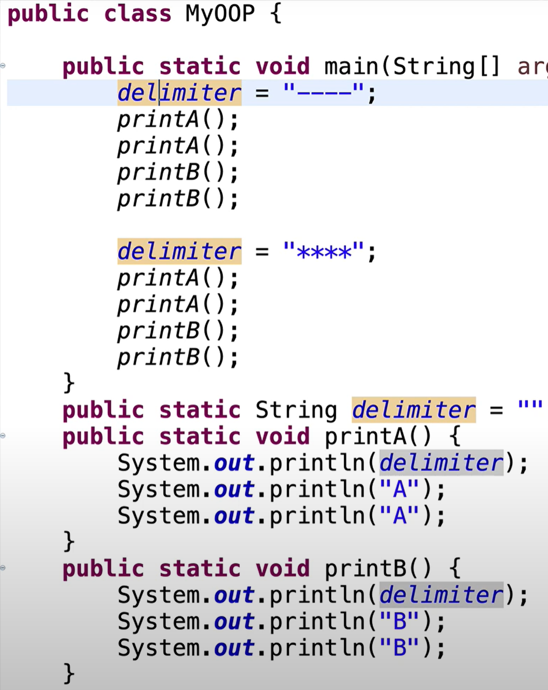

My00P 클래스 안에 각각의 프린트 메소드를 사용했음

-&gt; 개수가 많아진다면 변수끼리의 관계도 파악하기 어렵고 복잡해지겠죠?

```java
class Print{
    public static String delimiter = "";
    public static void A() {
        System.out.println(delimiter);
        System.out.println("A");
        System.out.println("A");
    }
    public static void B() {
        System.out.println(delimiter);
        System.out.println("B");
        System.out.println("B");
    }
}
public class MyOOP {
    public static void main(String[] args) {
        Print.delimiter = "----";
        Print.A();
        Print.A();
        Print.B();
        Print.B();
         
        Print.delimiter = "****";
        Print.A();
        Print.A();
        Print.B();
        Print.B();
    }
}
```

print 라는 class를 사용해서 같은 기능끼리 묶었음

동일한 성격의 일을 하는 코드를 각각의 클래스에 넣어둔다.

작성자의 의도를 파악하기 쉽고, 유지 보수가 용이해진다.

Refactor -&gt; move type to new file 의 기능을 이용해서 클래스를 다른 .java 파일로 자동으로 옮겨줌
