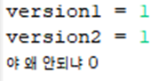
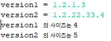

**오늘의 상황...**

**사용자에게 입력받고, 마침표를 기준으로 split 하여 ArrayList에 넣으려고 하는데...**

**Arrays.asList를 사용하면 된다고?**

```java
System.out.print("version1 = ");
	String v1 = sc.next();
	System.out.print("version2 = ");
	String v2 = sc.next();
	
	String[] v1_array = v1.split(".");
	String[] v2_array = v2.split(".");
	
	ArrayList<String> v1_list = new ArrayList<String>(Arrays.asList(v1_array));
	ArrayList<String> v2_list = new ArrayList<String>(Arrays.asList(v2_array));
```

### Arrays.asList 가 뭐지?

아하! Array를 List로 변환해주는 친구였다.

Array에서 ArrayList로 갈 때 하나씩 옮기는 방법 외에,

Arrays.asList()가 가장 많이 사용하는 방법이다.

주의할 점

- 원래 만들어진 배열의 인스턴스를 가리킴!

- 원본 배열도 함께 바뀌게 됨!

- 만든 List에 새로운 원소를 추가/삭제 불가!

- 이 때문에 초기화된 리스트는 ArrayList처럼 자유롭게 변경할 수 있는 특성을 갖지 못한다.!!!!

- 변경하고 싶으면 ArrayList 클래스의 생성자에, 만들어진 List 자료구조를 넣어서, 새롭게 만들어진 ArrayList 인스턴스를 참조하도록 해줘야 함!!

### 어.. List 랑 ArrayList 다른 거 아니야?

```java
ArrayList<Object> list = new ArrayList <>();
List<Object> list = new ArrayList<>();
```

위의 두 줄은 같은 결과를 도출하지만

List를 사용해서 ArrayList를 생성하는 것은 유연성에서의 효과를 볼 수 있다.

즉, String과 Integer 등등 여러 데이터의 삽입과 삭제를 유연하게 하기 위해서 List를 사용한다는 것.

비유하자면, List는 도형이고 ArrayList는 정사각형.

ArrayList에는 정사각형만 들어가는데, List에는 정사각형, 정삼각형, 삼각형 등등 들어갈 수 있다는 말씀

---

자.. 다시 돌아와서 ..

array에 넣는 과정 없이 바로 split한 배열을 List 생성과 동시에 넣어버리면 되겠네.

```java
System.out.print("version1 = ");
	String v1 = sc.next();
	System.out.print("version2 = ");
	String v2 = sc.next();
	
	List<String> v1_list = new ArrayList<String>(Arrays.asList(v1.split(".")));
	List<String> v2_list = new ArrayList<String>(Arrays.asList(v1.split(".")));
```

자.. 근데 왜 List의 크기가 자꾸 0이지?



*감히 부려본 땡깡...*

### 메타 문자 구분자로 사용하려면 이스케이프 문자인 "\\"를 붙여줘야 한다....

~~그래서 그동안 안 된 거구나?~~

```java
List<String> v1_list = new ArrayList<String>(Arrays.asList(v1.split("\\.")));
List<String> v2_list = new ArrayList<String>(Arrays.asList(v1.split("\\.")));
```



*편-안*

---

이렇게 오늘의 과제에서도 배울 점 가득

Reference :

[[Java] Arrays.asList (tistory.com)](https://youngsubee.tistory.com/entry/Java-ArraysasList)

[자바의 Arrays.asList (velog.io)](https://velog.io/@bahar-j/%EC%9E%90%EB%B0%94%EC%9D%98-Arrays.asList)

[[JAVA] Arrays.asList() : 네이버 블로그 (naver.com)](https://m.blog.naver.com/roropoly1/221140156345)

[[JAVA 자바] String클래스의 split 메서드로 문자열 분리하는 법. 문자열 파싱. StringTokenizer, substring와 차이? (tistory.com)](https://jhnyang.tistory.com/336)
