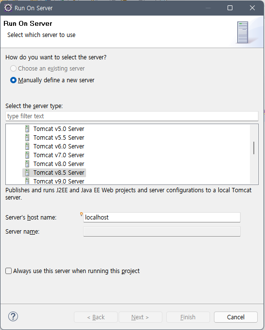
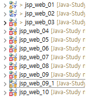
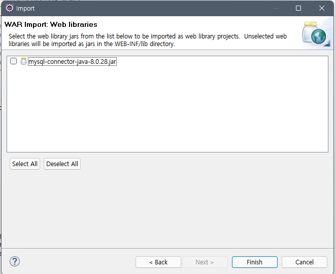
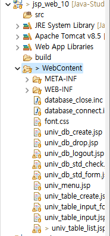

나는 지금 톰캣 서버와 sql을 연결해서 JSP 웹 개발을 공부 중이다. 그러던 중, 프로젝트 하나를 war파일로 묶어 다시 열었는데, 다짜고짜 에러가.....

> 우리... 좋았잖아.....

자.. run하니 위 같은 상황이 나오는데... 원래는 Tomcat v8.5 Server로 Finish 버튼이 활성화되어야 한다.

뭐가 문젤까. 흠

*내가 import한 프로젝트들*

자.. 프로젝트들을 보자.

위는 내가 공부하면서 만든 Dynamic web Project들이다.

09_1 버전을 war하여 10으로 그대로 다시 만드니, 10은 물론이고 3, 4, 5, 6, 7, 8, 9가 전부 run해도 반응이 없는 (?) 에러가 뜬다.

근데.. 09_1은 잘 된다 !?

1번 방법

상단 Project - properties - Project Facets - 오른쪽 보면 Runtimes에 Apache Tomcat 있는지 확인, 있으면 체크, 없으면 new - 깔았던 Tomcat 버전 누르고 next - tomcat 폴더 browse 끝

2번 방법

상단 Project - properties - Java Build Path - Libraies에 Apache Tomcat 있는지 확인 - 없으면 Add Library - Server Runtime 더블 클릭 - Apache Tomcat 선택

3번 방법

Tomcat 재설치, 연결했던 Server도 다 날려줌. 그냥 처음부터 다시!!

> 이래도 안 됨.. 구글링 ㄱㄱ

[Eclipse] Run on server가 없을 경우 해결 방법 (tistory.com)](https://yjh5369.tistory.com/entry/Eclipse-Run-on-server%EA%B0%80-%EC%97%86%EC%9D%84-%EA%B2%BD%EC%9A%B0-%ED%95%B4%EA%B2%B0-%EB%B0%A9%EB%B2%95)

[🔗 Eclipse] Run on server가 없을 경우 해결 방법](https://yjh5369.tistory.com/entry/Eclipse-Run-on-server%EA%B0%80-%EC%97%86%EC%9D%84-%EA%B2%BD%EC%9A%B0-%ED%95%B4%EA%B2%B0-%EB%B0%A9%EB%B2%95)

에서 4번 방법으로 해도 안 됨.

구글링 해서 갖가지 따라 해도 안 됨

---

## 자 그럼 에러가 났던 순간으로 돌아가 보자.

## 어디서부터 에러가 났지?

## war파일을 import 하고 나서 에러가 났었지.

> 그럼 내가 war파일 import를 잘못했나 보다.
> 다시 import 해보자.

어....... 아까 내가 이거 체크했었나????

이건 tomcat이 아니라 mysql 연결하는 jar 파일인데.

암튼....

체크해주고 finish!!!!!!

---

*빨간 x 없이 깰~끔*

### 또잉?!!!!

### tomcat 서버 살아났냐 왜!?!!?

안 되던 기존 10은 삭제해주고 파일 갈아 끼워줌

야 대체 뭐가 문제였던 거냐?... ㅂㄷㅂㄷ

---

얼떨결에 해결해버렸다... 다행이긴 한데....... 이 찝찝함은 뭐지?!!!!

하나는 배웠다.

에러가 나면, **에러 났던 순간으로 되돌아가 볼 것.**
