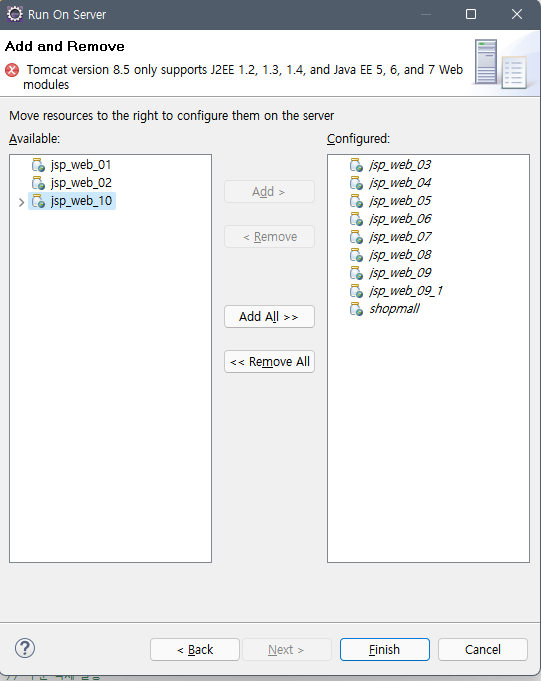
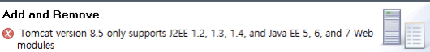
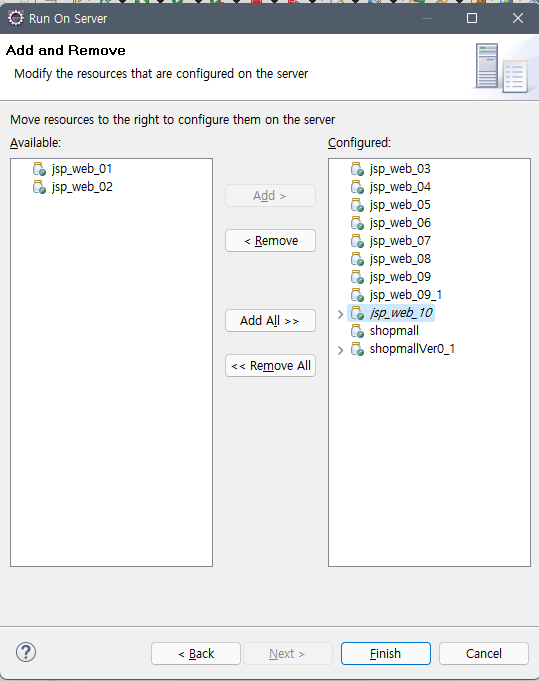

어제 포스팅 했던 에러의 연장선

Run on Server에서 Add and Remove 단계를 확인했다.
프로젝트 명 jsp_web_10에서

**Tomcat version 8.5 only supports J2EE 1.2, 1.3, 1.4, and Java EE 5, 6, and 7 Web modules**

이라는 **에러 메세지**와 함께 Configured 박스로 옮겨지지 않았다.

*에러나는 Run on Server*

*에러 메세지*

---

#### 에러 원인

서버 버전과 Web Module 버전끼리 호환이 되지 않는 경우,
원하는 서버 버전으로 실행이 불가했다.

나는 톰캣 8.5를 다운받아 사용 중이었고, Tomcat 8.5가 Dynamic Web Module 4.0을 지원하지 않았기 때문에
발생한 오류였다.

#### 해결 방법

첫번째 방법, Dynamic Web Module 4.0을 지원하는 Tomcat 9.0을 설치해서 사용한다.

두번째 방법, Dynamic Web Module 4.0의 버전을 낮춘다.

---

나는 두번째 방법으로 해결했다.
그렇다면,

#### Dynamic Web Module 4.0의 버전을 낮추는 방법 두 가지

첫번째 방법,
상단 Project - Properties - Project Facets 에서 Dyanmic Web Modules의 버전을 바꿔준다

두번째 방법, (나는 이 방법으로 해결)
해당 프로젝트 폴더로 가서
.setting / org.eclipse.wst.common.project.facet.core.xml 에서 버전 정보를 수정한다.

> &lt;?xml version="1.0" encoding="UTF-8"?&gt;
> &lt;faceted-project&gt;
> &lt;fixed facet="jst.web"/&gt;
> &lt;fixed facet="wst.jsdt.web"/&gt;
> &lt;fixed facet="java"/&gt;
> &lt;installed facet="java" version="1.8"/&gt;
> &lt;installed facet="jst.web" version="**3.1**"/&gt;
> &lt;installed facet="wst.jsdt.web" version="1.0"/&gt;
> &lt;/faceted-project&gt;

**3.1로 바꾸어주기**

원래는
&lt;installed facet="jst.web" version="4.0"/&gt; 에서 버전이 4.0으로 되어 있다.
4.0을 3.1로 바꾸어준다.

---

**그랬더니 ~ 두둥**

#### 에러 해결

아주 잘 넘어가쥬?

^^ 에러 해결~

---

reference :

[Tomcat version 8.5 only supports J2EE 1.2, 1.3, 1.4, and Java EE 5, 6, and 7 Web modules (tistory.com)](https://abn-abn.tistory.com/198)

[🔗 Tomcat version 8.5 only supports J2EE 1.2, 1.3, 1.4, and Java EE 5, 6, and 7 Web modules](https://abn-abn.tistory.com/198)
