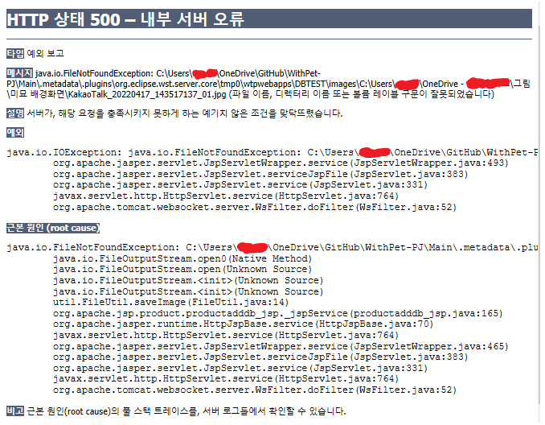
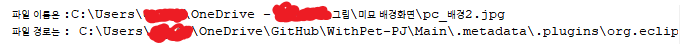
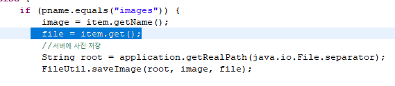
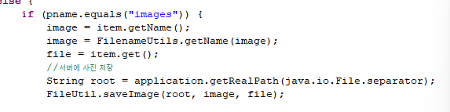
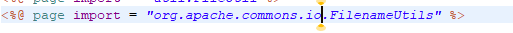
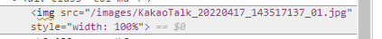
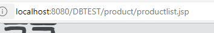

## DB에 이미지 넣고, DB에서 꺼내 이미지 출력하기

### 진행하려는 플로우

#### 1단계 &gt; productadd.jsp

프런트 화면에서 사용자가 input 하기 위한 jsp문이다.

### ↓

#### 2단계 &gt;productadddb.jsp

input 내용을 전달받아 DB에 insert하기 위한 jsp문이다.

단, image 파일의 파일명만 가져가서 서버폴더로 따로 저장해줘야 한다.

따라서,

1. 서버 폴더에 저장하기 위해 FileUtil로 경로 다 떼고 이름만 남은 image 파일을 보낸다.

2. DB에 넣을 image파일 또한 경로 다 떼고 이름만 가져간다.

(이렇게 하는 이유는, DB에서 꺼내올 때 &lt;img src="/서버 폴더/images"&gt; 이런 식으로, 서버 폴더 내에 저장시켜놨던 image를 가져오기 위함이다.)

### ↓

#### 3단계 &gt;FileUtil.jsp

productadddb.jsp에서 받은 image 파일을 서버의 image 폴더에 저장한다.

### ↓

**다시 돌아와서,**

#### 4단계 &gt;productadddb.jsp

ProductDAO의 메서드를 선언해서 DB에 insert 한다.

insert에 성공하면 productlist.jsp를 실행해서 DB의 데이터를 뽑아 출력한다.

### ↓

#### 5단계 &gt;productlist.jsp

DB에서 데이터를 꺼내 출력한다.

---

### 에러 내용

*에러를 잘 보자. 이미지 경로가 잘못저장되어 파일을 찾을 수 없다고 나온다.*

메시지를 잘 보자.

FileNotFoundException -&gt; 파일을 찾을 수 없다는 거다. 이런 건 대부분 경로 문제다. 사용자가 선택한 image의 경로가 잘못 쏴지고 있다.

에러 메시지에서 image의 로컬 경로가 통째로 출력된다.

productadddb.jsp에서는 item.getName();으로 로컬 경로에서 파일명만 잘라준다. 분명 잘랐는데도 왜 로컬 경로가 모두 나오는 걸까?

---

### 해결 과정

**에러 나는 위치를 추측해보자.**

일단, input 하는 데까진 문제가 없다. 사용자가 선택한 image 파일도 productadddb.jsp 까지는 잘 넘어갔다.

**2단계 또는 3단계에서 에러가 있다는 말이다.**

먼저, 서버 폴더에 전혀 저장되고 있지 않으니 FileUtil에서 서버 폴더의 경로를 잘 설정해줬는지 확인해보자.

서버폴더의 경로를 출력해서 체크해보자.

슬래시(/)와 역슬래시(\)를 혼동하여 사용했음을 발견했다.

네트워크 상의 경로에는 슬래시(/) , OS상의 경로에는 역슬래시(\)를 사용해야 한다.

따라서 서버 폴더는 OS상의 경로므로 \를 사용했어야 했다.

**-&gt; 서버 폴더 경로 수정 완료!**

그럼 과연 서버 폴더에 저장이 잘 될까?

**여전히 안 된다.**

그렇다면 FileUtil에서 파일명을 출력해보자.

경로 다 떼고 진짜 파일명만 나와야 제대로 나오는 거다. (productadddb.jsp에서 image의 파일명만 자른다.)

*FileUtil에서 파일명*

확인했더니 파일 이름에서 로컬 경로까지 모두 출력되는 것을 볼 수 있다.

로컬 경로까지 출력되면 안 된다.

파일명만 출력되어야 한다.

---

분명 productadddb.jsp에서 image=item.getName();으로 파일명만 잘랐는데, 왜 파일 이름이 전혀 잘리지 않았을까.

---

*FilenameUtils.getName(); 추가*

**-&gt;**

**getName(); 사용 후에**

**FilenameUtils.getName();으로 파일명을 잘라줘야 한다. 그럼 진짜 "파일명"만 저장이 된다.**

*import할것.*

까먹지 말고 import도 해주자

---

그랬더니,,,,,,

**서버 폴더에 image가 저장이 된다.**

**DB에도 잘 들어간다.**

4단계까지 성공했다는 말이다.

그럼 이제 DB에서 꺼내 출력해야 한다.

---

**5단계, productlist.jsp에서.... 엑박이 뜬다**

하지만 여기서부턴 간단하다. db에서 꺼내오는 것만 하면 되기 때문.

엑박은 대부분 경로 문제이기 때문에, &lt;img src=""&gt; 태그를 점검해본다.

일단 주의할 점은 아까도 말했다시피 src에서 경로는 네트워크 경로기 때문에 슬래시(/)를 사용해야 한다.

**개발자 도구 검사를 해보자.**

*개발자도구 검사*

(서버 폴더 안의) images/파일명...

잘 출력되고 있는데 왜 안될까.

그러다 문득 productlist.jsp의 주소를 확인해보는데, localhost:8080 뒤에 DBTEST (프로젝트명)이 있는 것을 보았다.

*productlist 주소*

그래서 서버 폴더로 직접 들어가 봤다.

*서버폴더*

wtpwebapps까지가 서버 폴더다.

즉,

서버 폴더 -&gt; images 폴더로 바로 가는게 아니라,

서버폴더 -&gt; 프로젝트 폴더 -&gt; images 폴더로 가야 한다.

따라서 &lt;img src="/프로젝트명/images/파일명"&gt;으로 주소를 작성해야 올바른 경로로 이미지가 출력된다.

정리하자면, 서버 폴더의 경로를 잘 확인해서 image가 저장되는 images 폴더가

**서버 폴더(wtpwebapps) 아래에 어떤 경로로 있는지 파악**하고,

그 경로를 &lt;img&gt; 태그로 선언해줘야 한다.

*서버폴더*

---

그래서 결론... 아주아주 많았던

### 에러 원인

1. 네트워크 경로, OS 경로 혼동 (슬래시, 역슬래시 혼동)

2. 파일명 제대로 안 잘라줌

3. 서버 폴더 내 images 폴더 경로 오류

---

## 디버깅하는 자세

첫째, 오류 예상되는 지점에서 print 같은 걸로 잘 전달되는지 확인해보기

둘째, 서버 돌릴 때 개발자 도구에서도 확인해보기

셋째, 성공하는 이유는 하나, 실패하는 이유는 수만 가지

넷째, 한 번에 성공?? 내가 모르는 에러가 있다는 거다. 무슨 에러인지 나오는 것에 감사하자

## 궁금했는데 알게 된 것

첫째, main 메서드 없이 import만 하면 print 할 수 있다는 거;

둘째, 자바에서 제공하는 메서드, 유틸, 등등 잘 모르면 검색해보자. 반환하는 데이터 타입까지 알 수 있다.

셋째, 역슬래시는 두 번 써줘야 자바가 알아먹는다.
