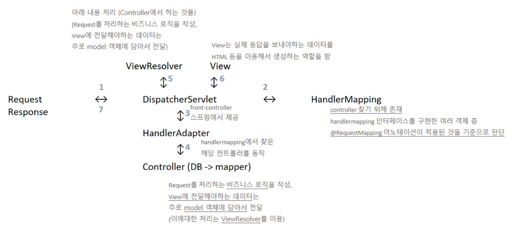

### MVC 모델이란?

MVC (Model - View - Controller) 모델은 사용자 인터페이스, 데이터 및 논리 제어를 구현하는 데 사용되는 소프트웨어 디자인 패턴이다. MVC 패턴을 사용하면 business logic과 presentation logic을 분리하기 쉽고 유지보수가 편리해진다.

#### Model

모델은 데이터를 조회했을 때 결과를 담을 수 있는 저장공간이 모여있는 클래스를 말한다. 즉 애플리케이션이 포함해야 할 데이터가 무엇인지를 정의한다.

#### View

화면 구현(html, jsp, css 등) 방식을 정의한다.

#### Controller

데이터베이스에 접근하는 메서드들이 모여있는 곳이다. 애플리케이션의 사용자로부터 입력에 대한 응답으로 모델, 뷰를 업데이트하는 로직을 포함한다.

---

*front-controller 패턴의 흐름*

스프링 프로젝트에서 front-controller 패턴을 사용하면 공통적인 코드 처리가 가능해지고, front-controller 외의 다른 controller에서 servlet을 사용하지 않아도 된다는 장점이 있다.

## Front Controller 패턴의 흐름

### 1. 가장 먼저 사용자의 요청(Request)가 DispatcherServlet으로 들어온다.

#### ✔️ DispatcherServlet

'dispatcher'는 '보내다'라는 뜻을 가지고 있다. HTTP 프로토콜로 들어오는 모든 요청(Request)을 가장 먼저 받아서 적합한 컨트롤러에 위임해주는 프런트 컨트롤러(Front Controller)라고 정의할 수 있다.

스프링이 제공해주며, DispatcherServlet가 등장하면서 web.xml의 역할이 상당히 축소되었다. 전에는 모든 서블릿을 URL 매핑을 위해 web.xml에 모두 등록해주어야 했지만, DispatcherServlet이 해당 애플리케이션으로 들어오는 모든 요청을 핸들링해주고 공통 작업을 처리하면서 상당히 편리해졌다. 따라서 개발자는 컨트롤러만 구현해주면 DispatcherServlet이 알아서 적합한 컨트롤러로 위임해주는 구조가 되었다.

### 2. DispatcherServlet에서 HandlerMapping로 이동하여 컨트롤러를 맵핑한다.

#### ✔️HandlerMapping

'Handler'는 Controller를 의미한다. 즉 이곳은 컨트롤러를 찾기 위해 존재한다. HandlerMapping 인터페이스를 구현한 여러 객체 중에서 @RequestMapping 어노테이션이 적용된 것을 기준으로 판단한다.

구체적인 동작방식은 이렇다.

등록되어있는 HandlerMapping들을 loop 하면서 HandlerMapping 들에게 request에 맞는 handler를 가져오게 하고, 가져왔다면 그 hanlder를 return 한다.

### 3. 다시 DispatcherServlet으로 돌아가고 이는 HandlerAdapter로 이동한다.

#### ✔️HandlerAdapter

방금 전 HandlerMapping에서 찾은 컨트롤러를 동작시키는 곳이다. 'Adapter'는 다른 전기나 기계 장치를 서로 연결해서 작동할 수 있도록 만들어주는 결합 도구를 의미한다. 컨트롤러 Adapter라고 이해하면 된다. DispatcherServlet은 이곳을 통해 컨트롤러를 호출한다.

### 4. Controller를 호출한다.

컨트롤러를 호출하고, DB와 연결하는 작업이 이루어진다.

#### ✔️Controller

앞서 사용자가 요청했던 Request를 처리하는 비즈니스 로직이 작성된 곳이다. View에 전달해야 하는 데이터는 주로 Model 객체에 담아서 전달한다. (이에 대한 처리는 ViewResolver가 담당한다.)

### 5. 작업이 이루어진 후 다시 DispatcherServlet로 돌아가고, ViewResolver로 이동한다.

#### ✔️ViewResolver

컨트롤러에서 받은 View 이름으로 실제 사용할 View를 찾아주는 역할을 한다. 'Resolver'는 '해결자'라는 의미를 담고 있다.

### 6. 다시 DispatcherServlet로 돌아가서 View로 이동한다.

#### ✔️View

이곳은 실제 응답을 보내야 하는 데이터를 HTML 등을 이용해 생성하는 역할을 한다.

### 7. 다시 DispatcherServlet로 돌아가서 사용자에게 Response 한다.

---

**[ Reference ]**

[MVC - 용어 사전 | MDN (mozilla.org)](https://developer.mozilla.org/ko/docs/Glossary/MVC)

[[Spring] Dispatcher-Servlet(디스패처 서블릿)이란? 디스패처 서블릿의 개념과 동작 과정 - MangKyu's Diary (tistory.com)](https://mangkyu.tistory.com/18)

[Spring 요청의 흐름(Spring MVC 패턴) — wellbell의 개발일기 (tistory.com)](https://wellbell.tistory.com/137)

아래는 DispatcherServlet과 HandlerMapping의 구체적인 동작 방식이 서술되어 있다.

[Spring MVC - HandlerMapping의 동작방식 이해하기 1편 (velog.io)](https://velog.io/@hsw0194/Spring-MVC-HandlerMapping%EC%9D%98-%EB%8F%99%EC%9E%91%EB%B0%A9%EC%8B%9D-%EC%9D%B4%ED%95%B4%ED%95%98%EA%B8%B0-1%ED%8E%B8)
