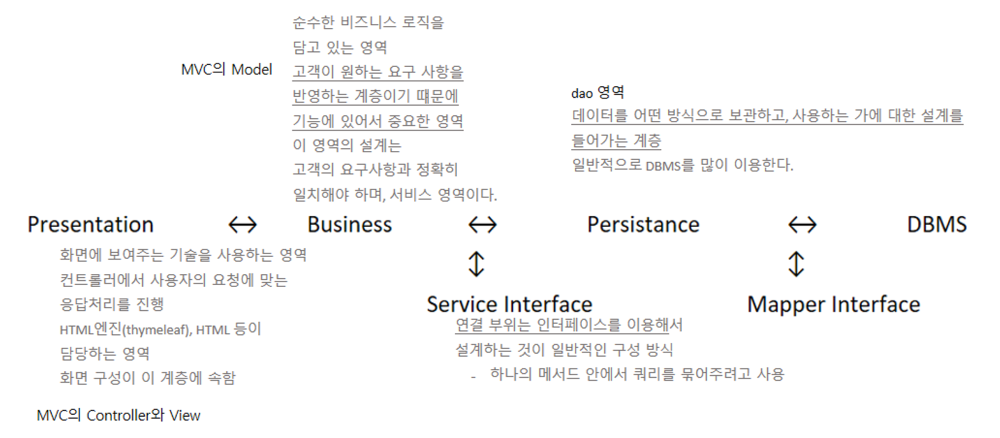
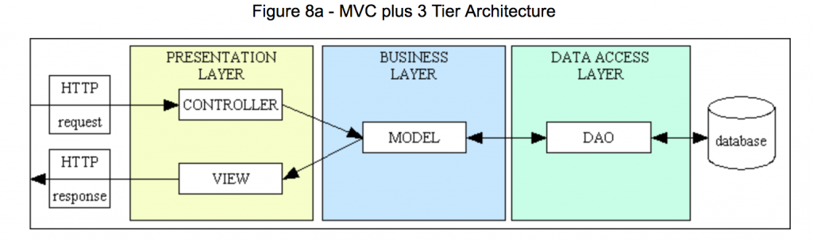
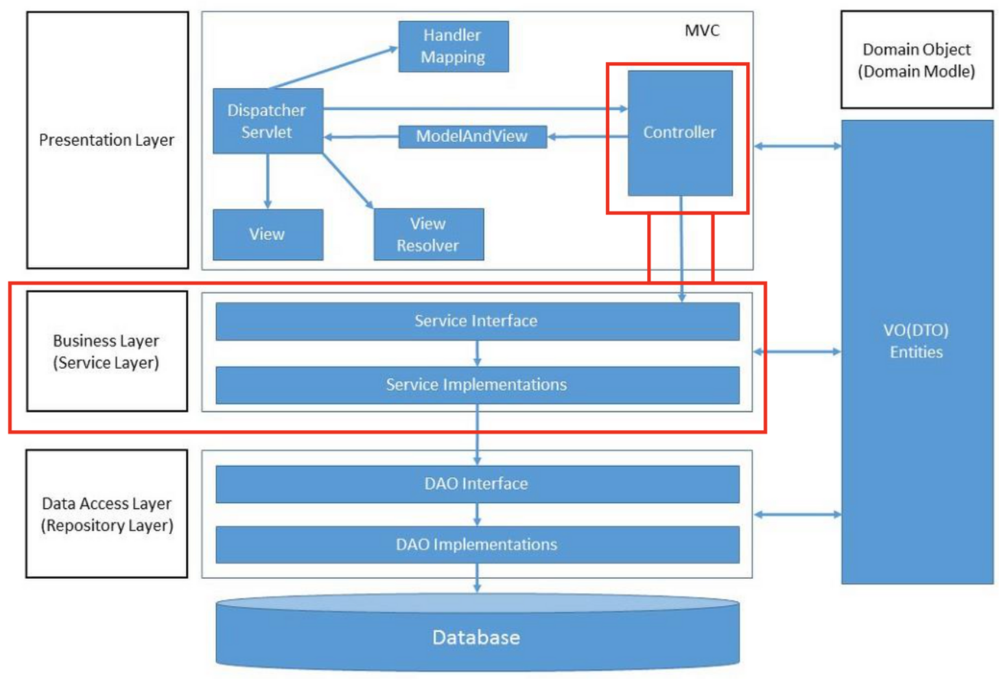

*스프링 3-tier 구성방식의 흐름*

스프링 프로젝트를 3-tier로 구성하는 일반적인 이유는 **유지보수**에 있다. 각 영역을 독립적으로 설계해서 나중에 특정 기술이 변하더라도 필요한 부분만 교체하면 되기 때문이다. 따라서 각 영역은 설계 당시부터 영역을 구분하고, 해당 연결 부위는 인터페이스를 이용해서 설계한다.

## Presentation Tier (화면 계층)

화면에 보여주는 기술을 사용하는 영역이다. 컨트롤러에서 사용자의 요청에 맞는 응답처리를 진행한다. HTML 엔진 (thymeleaf), HTML 등이 담당한다. Spring MVC 객체를 말하기도 하며, 프론트 컨트롤러 (DispatcherServlet), 컨트롤러, 뷰가 포함된다.

서비스 계층, 데이터 엑세스 계층에서 발생하는 Exception을 처리한다.

@Controller 어노테이션을 사용하여 작성된 Controller 클래스가 이 계층에 속한다.

## Business Tier (비즈니스 계층)

순수한 비즈니스 로직을 담고 있는 영역이다. 고객이 원하는 요구사항을 반영하는 계층이므로 중요하다. 이 영역의 설계는 고객의 요구사항과 정확히 일치해야 하며, 서비스 영역이다. Presentation Tier와 Persistance Tier의 중간다리 역할을 한다. 일반적으로 이 비즈니스 계층에 있는 객체들은 Service라는 용어를 많이 사용한다. 비즈니스 영역을 담당하는 인터페이스는 Service, 인터페이스를 구현한 클래스는 ServiceImpl이라는 이름을 사용한다. MVC의 Model 부분이다.

Service 인터페이스와 @Service 어노테이션을 사용하여 작성된 Service 구현 클래스가 이 계층에 속한다.

## Persistance Tier (영속 혹은 데이터 계층)

데이터를 어떤 방식으로 보관하고 사용하는 가에 대한 설계가 들어가는 계층이다. 일반적으로 DBMS를 많이 이용한다. 경우에 따라서는 네트워크 호출이나 원격 호출 등의 기술이 접목될 수 있다.

DAO 인터페이스와 @Repository 어노테이션을 사용하여 작성된 DAO 구현 클래스가 이 계층에 속한다.

DB에 data를 CRUD하는 계층이다.

### Business와 Persistance를 연결하는 Service Interface

연결 부위는 인터페이스를 이용해서 설계하는 것이 일반적인 구성 방식이다.

---

## 3-tier  vs  MVC

**3-tier는 'Architecture' , MVC는 'pattern'**

3-tier Architecture는 각각 물리적으로 독립된 모듈로 개발하고 유지하는 구조다. 각 계층은 접촉 계층과 통신만 하면 된다. 무조건 비즈니스 계층을 통해야한다.

MVC pattern은 물리적으로 구분할 수 없다. 즉 MVC pattern 이라는 디자인 패턴은 물리적으로 구분할 수 없는 설계를 문서화하면서 고안된 방법이다. 프로그램의 규모가 커질수록 다양한 문제를 겪게 되는데, 이 문제들을 효율적으로 해결할 수 있게 하기위해 유형별로 패턴화 한 것이다.

즉 3-tier가 물리적으로 구분되어 있고, 이 안에 MVC가 통신 중이라고 표현할 수 있다.

### 참고 사진

*MVC 와 3-tier의 관계*

*MVC 와 3-tier의 관계*

---

**[ Reference ]**

[3-tier vs MVC (velog.io)](https://velog.io/@chlee4858/3-tier-vs-MVC)

[[Spring Boot] 3-tier(티어) 아키텍처 (tistory.com)](https://hongs-coding.tistory.com/119)

[[Spring] 스프링 웹 계층이란? :: Gyun's 개발일지 (tistory.com)](https://devlog-wjdrbs96.tistory.com/209)
