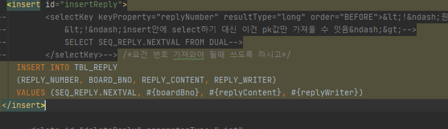

### 에러 메시지

org.mybatis.spring.MyBatisSystemException: nested exception is org.apache.ibatis.type.TypeException: **Could not set parameters for mapping: ParameterMapping{property='replyNumber', mode=IN, javaType=class java.lang.Object, jdbcType=null, numericScale=null, resultMapId='null', jdbcTypeName='null', expression='null'}. Cause:** org.apache.ibatis.type.TypeException: Error setting null for parameter #1 with JdbcType OTHER . Try setting a different JdbcType for this parameter or a different jdbcTypeForNull configuration property. Cause: java.sql.SQLException: 부적합한 열 유형: 1111

### 에러 원인

null ? 들어와야 하는 게 안 들어왔다는 거 같다.

REPLY_NUMBER 컬럼을 생략했던 게 문제였다.

### 에러 해결

내가 원하는 것은 REPLY_NUMBER를 추가해주지 않아도 자동으로 insert 되는 것을 상상했으나

자리에 CREATE SEQUENCE 했던 SEQ_REPLY.NEXTVAL 을 넣어주어야 했다.

아..

이제서야 null이 안 뜬다.
