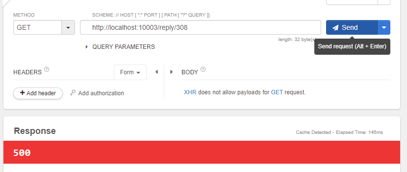
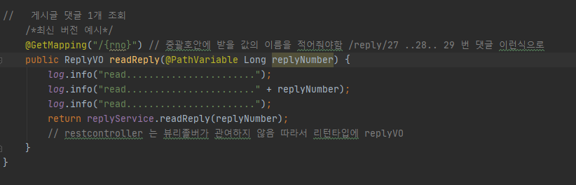
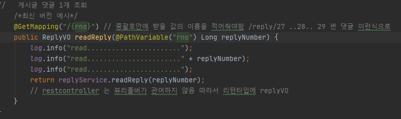

### 에러 메시지

Required **URI template variable** 'replyNumber' for method parameter type Long is not present]

uri template variable이라고 하는 것 보니 @PathVariable 어노테이션과 관련있는 것 같다.

### 에러 원인

@PathVariable에서 ()로 url 값을 할당해주지 않았다.

### 에러 해결

---

### @PathVariable 어노테이션이란?

클라이언트 측에서 url에 파라미터를 같이 전달하는 경우가 있다. 예시를 들자면 게시판 127번 글을 출력하는 URL일때,

http://localhost:1000/board/127 처럼 말이다. 이럴 때 스프링에서 전달인자를 처리하는데 이 때 사용하는 것이 @PathVariable 어노테이션이다.

말 그대로 URL 경로에 변수를 넣어주는 것이다. 위 사진처럼 URL 부분에 { } 를 이용하여 파라미터를 받을 변수를 정해준다. 파라미터 자리에 @PathVariable ()를 추가하고 소괄호안에는 URL에 적어준 변수를 넣어준다.

#### 사용시 주의사항

null 이나 공백값은 적용하지 말자.

스프링에서는 . (온점)이 포함되어 있으면 온점을 포함하여 그 뒤가 잘려서 들어온다는 점을 주의하자.

---

**[ Reference ]**

[오늘은 @pathvariable 어노테이션! (sarc.io)](https://sarc.io/index.php/development/1145-pathvariable)
