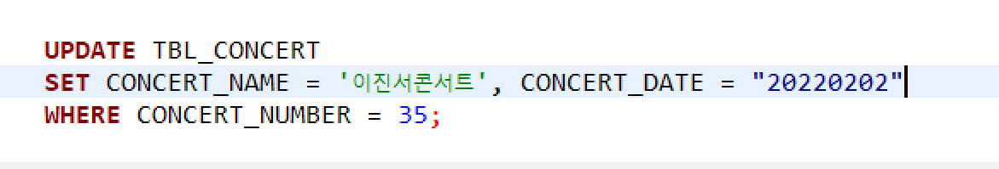

### 에러 메시지

SQL Error [904] [42000]: ORA-00904:

### 에러 원인

입력된 열 이름이 누락되었거나 잘못 되었을 경우 발생한다.

- 존재하지 않는 열 이름을 지정함

- 정의된 열 이름과 대소문자가 일치하지 않는 경우

- 작은 따옴표(')와 큰 따옴표(") 사용 방법의 오류

- 열 이름에 특수 문자 사용

- 열 이름에 Oracle 예약어 사용

이 중 세번째, 따옴표 사용에서 문제가 있었다.

### 에러 해결

작은 따옴표를 사용해서 값으로 취급해주고 해결했다.

문자열을 표현하기 위해 "이진서콘서트" 와 "20220202" 로 작성했더니 오류가 났다.

따라서 둘다 ' ' 작은 따옴표로 감싸주니 잘 실행되었다.

*왼) 옳은 예시 / 오) 틀린 예시*

[ Reference ]

[[Oracle] ORA-00904 : 부적합한 식별자 invalid identifier :: 신변잡기 분석 및 설계 (tistory.com)](https://forwe.tistory.com/9)

[[Oracle] ORA-00904 : 부적합한 식별자 invalid identifier 오류 (tistory.com)](https://haenny.tistory.com/114)
