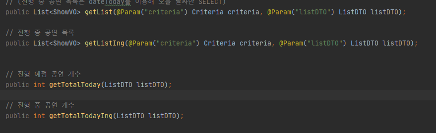
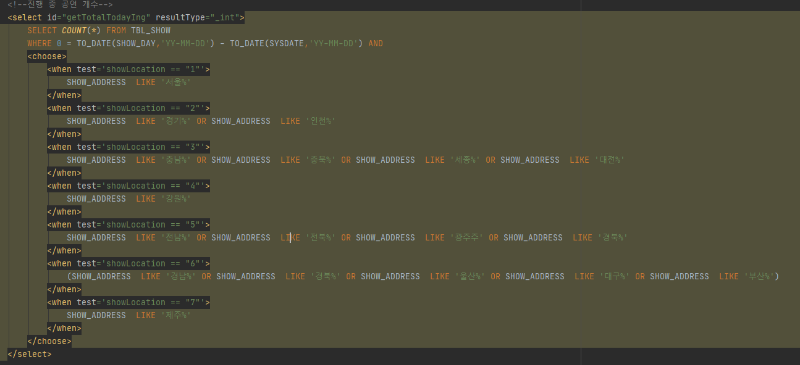
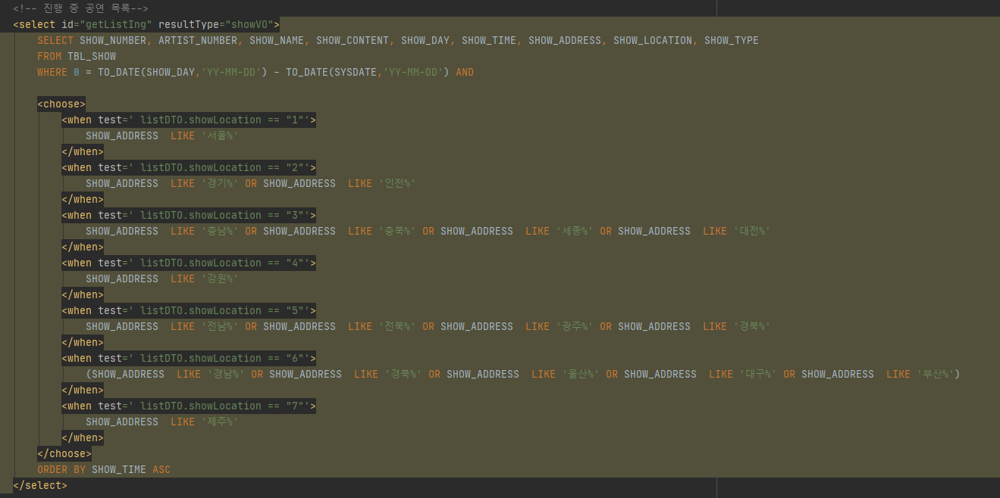

**에러 메세지**

org.mybatis.spring.MyBatisSystemException: nested exception is org.apache.ibatis.reflection.ReflectionException: There is no getter for property named 'listDTO' in 'class co[m.example.teamprojeect.domain.vo.list.ListDTO'](http://m.example.teamprojeect.domain.vo.list.ListDTO')

<https://twofootdog.github.io/Mybatis-There-is-no-getter-for-property-named-%EC%97%90%EB%9F%AC/>

[🔗 [Mybatis]There is no getter for property named 에러 | 두발로걷는개](https://twofootdog.github.io/Mybatis-There-is-no-getter-for-property-named-%EC%97%90%EB%9F%AC/)

**나의 삽질**

오타라길래 눈을 씻고 찾아보는데 대체 어디가 오타인거야?

1. 다시 에러 구문 분석..

listDTO가 config에 없어서 그런가? config에 추가 -&gt; 하지만 효과 없음. config는 resultType에서 alias로 등록해서 쓰려고 하는거니까!

2. 다시 에러 구문 분석... listDTO가 문제인거같은데..

3. sysdate 까지만 쓰고 돌려봤음

성공!?

진짜 listDTO가 문제인가봐

4. mapper로 간다...

아니 getlist들은 다 잘 되는데 왜 total이 안 되지?

어? 전달하는게 total은 하나구나 혹시 이건가?

아~ criteria.pagenum은~ 여기가 여기 있는 변수라고 알려줘야해서 그런가보다

혹시?

5. 하고 listDTO 지워봣더니 해결ㅋ

**해결**

param이 하나면 listDTO. 안 해줘도 됨..

