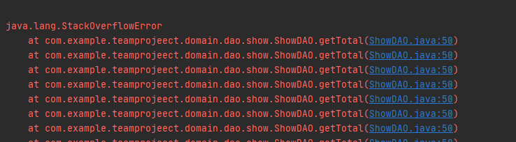
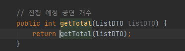

컴퓨터는 비명을 지름

하지만 에러 사랑꾼인 나는 조금도 놓치지않고 스택오버플로우라며 좋아 날뛰었다. ~~실제로 보는 건 처음이기때문...~~

인증샷 먼저 박고 디버깅을 해볼까!

**에러 원인**



아.. business 설계 담당자가 showmapper. 를 빠트려서 메소드 무한 반복... ㅋㅋㅋㅋㅋㅋㅋㅋㅋㅋㅋㅋㅋㅋ

**에러 해결**

```bash
Public int getTotal(ListDTO listDTO) {
	return showmapper.getTotal(listDTO)
    }
```

---

깨알 지식

## stack overflow 란?

지정한 스택 메모리 사이즈보다 더 많은 스택 메모리를 사용하게 되어 에러가 발생하는 상황을 일컫는다.

stack overflow 는 언제 발생하는가?

1. 재귀 함수

재귀 함수는 스택 오버플로우의 대표적인 사례다.

예시를 보자. 전달 받은 임의의 수 범위까지 1부터 곱해 나가면 된다.

```bash
public long calculateFactorial(long number) {
    return number == 1 ? 1 : number * calculateFactorial(number - 1);
}
```

함수를 호출할 때 **함수의 파라미터, 리턴 값, 복귀 주소 등**을 **스택에 저장**한다.

재귀 함수를 사용하면 호출한 함수가 종료되지 않은 채 새로운 함수를 호출하므로 스택에 메모리가 계속적으로 저장된다.

스택 메모리에 더 이상 가용 메무리가 없을 경우에 스택 오버 플로우가 발생한다.

---

**[ Reference ]**

**<https://incheol-jung.gitbook.io/docs/q-and-a/java/stw>**
